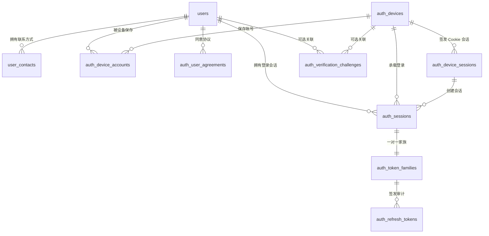

# C-53 登录注册模块数据库设计（v2.2）

> 依据：`docs/auth-api.md` v1.2、`docs/登录模块开发方案.md`  
> 正式 DDL：`C-53_be/src/main/resources/db/auth/auth-schema-v2.sql`  
> 历史版本：`docs/db/auth-schema.sql`（v1，仅保留参考，不再作为开发基线）  
> 目标数据库：MySQL 8.0；DDL 同时兼容 MySQL 5.7.8+  
> 状态：评审稿

## 1. 设计结论

本版在 v1 的 8 张表基础上重新拆分为 11 张表，核心变更如下：

1. 邮箱、手机号从 `users` 拆到 `user_contacts`，支持一人多联系方式、换绑和联系方式历史。
2. 设备与设备 Cookie 会话分层：`auth_devices` 表示稳定设备，`auth_device_sessions` 表示一次 Cookie 授权。
3. 已保存账号绑定 `device_id`，不再绑定一次性的设备会话，Cookie 轮换后仍能保留账号列表。
4. 新增 `auth_token_families`，会话和 Refresh Token 家族分离，支持家族级撤销与重复使用审计。
5. Refresh Token 白名单由 Redis 权威维护，MySQL 的 `auth_refresh_tokens` 只追加签发审计，不参与刷新验权。
6. 验证码挑战增加用户、设备、供应商、请求 ID 和 HMAC 密钥版本。
7. 登录审计保留历史 ID，但不对业务表建外键，避免清理会话后丢失审计链路。
8. 关键业务不变量由生成列和唯一索引兜底，而不是只依赖 Service 层判断。
9. v1 尚未部署，因此本版按全新初始化设计，不提供有损的在线升级脚本。

## 2. 设计目标

- 覆盖用户名、邮箱、手机号密码登录，以及短信、邮箱验证码登录和注册。
- 覆盖 Access Token 刷新、退出、`/me` 会话恢复、设备账号列表和快速切换。
- 验证码、Refresh Token、设备 Cookie 只保存 HMAC-SHA256 摘要，禁止明文落库。
- Redis 白名单是 Refresh Token 有效性的唯一权威源；MySQL 只保留签发审计。
- 用户名、联系方式、会话、Token 家族和协议同意记录在数据库层具备明确唯一性。
- 为登录失败、验证码发送和账号切换保留可追溯的审计数据。
- 高频限流仍由 Redis 承担；数据库负责持久审计和降级判断。
- 为后续换绑联系方式、找回密码、第三方登录和 MFA 预留结构。

## 3. v1 到 v2 的主要调整

| 主题 | v1 | v2.2 | 原因 |
|---|---|---|---|
| 联系方式 | `users.email/phone` 单值 | `user_contacts` 多记录 | 支持多邮箱/手机号、换绑历史，避免用户表中重复维护验证状态 |
| 设备身份 | 设备会话即设备 | `auth_devices` + `auth_device_sessions` | Cookie 轮换不应丢失已保存账号 |
| 已保存账号 | 绑定 `device_session_id` | 绑定 `device_id` | 设备会话过期或轮换后账号列表仍可恢复 |
| Refresh Token | 数据库轮换记录 | Redis 白名单 + `auth_token_families` + 签发审计 | 刷新验权更快，家族撤销和审计仍可追溯 |
| 验证码 | 目标、渠道、场景、摘要 | 增加 `user_id/device_id/provider/request_id/hmac_key_version` | 支持账号定位、追踪发送状态和密钥轮换 |
| 登录审计 | 记录会话/设备字段，部分依赖外键 | 保留历史 ID，不建业务外键 | 审计数据生命周期长于会话数据 |
| 会话约束 | 仅应用层保证一个当前会话 | 生成列 + 唯一索引 | 防止并发登录产生同一设备同一账号的多个活跃会话 |
| 唯一性 | 主要依赖应用层 | 联系方式、首要联系方式、Token 家族均建唯一索引 | 将关键不变量下沉到数据库 |

## 4. 表总览

| 表名 | 职责 | 主要接口 |
|---|---|---|
| `users` | 用户身份、密码摘要、公开资料、账号状态 | 注册、登录、`/me` |
| `user_contacts` | 邮箱/手机号、验证状态、首选联系方式 | 注册、密码登录、验证码登录 |
| `auth_devices` | 稳定设备身份、风险等级、最近访问信息 | 登录、设备账号 |
| `auth_device_sessions` | HttpOnly 设备 Cookie 的摘要、有效期和撤销状态 | `/auth/accounts`、`/auth/switch` |
| `auth_device_accounts` | 本设备已保存的用户及重新验证标记 | `/auth/accounts`、`/auth/switch` |
| `auth_sessions` | 一次登录会话，JWT 的 `sid` 指向此表 | 登录、刷新、退出、`/me` |
| `auth_token_families` | 一个会话对应的 Refresh Token 家族审计与撤销记录 | 退出、风控撤销 |
| `auth_refresh_tokens` | Refresh Token 签发审计，不参与刷新验权 | 刷新审计、安全复盘 |
| `auth_verification_challenges` | 短信/邮箱验证码挑战、尝试次数和发送状态 | `/auth/verification-codes`、注册、验证码登录 |
| `auth_login_attempts` | 登录/切换尝试审计，支撑限流和风控 | 登录、验证码登录、账号切换 |
| `auth_user_agreements` | 协议类型、版本、同意时间和来源信息 | 注册 |

## 5. 关系图

`auth_login_attempts.user_id/device_id/session_id` 是历史逻辑引用，不建外键。  
`auth_refresh_tokens.parent_token_id` 是父令牌的逻辑引用，不建自引用外键。

## 6. 表设计说明

### 6.1 `users`

保存用户身份和公开资料，不保存邮箱、手机号。

- `id`：业务 ID，格式 `usr_<ULID>`。
- `username`：小写保存，`ascii_general_ci` 唯一索引，3～24 位。
- `password_hash`、`password_algorithm`：当前实现使用 BCrypt cost 12；字段保留算法标识，后续可迁移 Argon2id。禁止明文。
- `status`：`ACTIVE / DISABLED / DELETED`；`deleted_at` 用于软删除。
- `last_login_at`、`password_changed_at`：登录和密码变更时间。
- `avatar_url`、`initials`、`profession`、`city`、`bio`：`AuthUser` 展示字段。

用户名唯一索引永久占用用户名。若后续允许注销后复用用户名，需要增加用户名释放策略，不能直接依赖软删除。

### 6.2 `user_contacts`

保存用户的所有邮箱和手机号，是登录账号定位的唯一来源。

- `contact_type`：`email / phone`。
- `contact_value`：邮箱统一小写，手机号统一 E.164；使用 `utf8mb4_bin` 做精确匹配。
- `verified`、`verified_at`：联系方式验证状态。
- `is_primary`：该用户、该类型下的首选联系方式。
- `status`：`ACTIVE / REMOVED`，移除时写 `removed_at`。
- `active_slot`：生成列，`ACTIVE` 为 1，否则为 NULL。
- `primary_slot`：生成列，`ACTIVE + is_primary=1` 为 1，否则为 NULL。

唯一约束：

- `uk_uc_value_active(contact_type, contact_value, active_slot)`：全局同一联系方式只能有一个 ACTIVE 记录。
- `uk_uc_user_primary(user_id, contact_type, primary_slot)`：每个用户每种类型最多一个 ACTIVE 首选联系方式。

生成列为 NULL 时不参与唯一冲突，因此可以保留多条 REMOVED 历史记录；重新启用某条记录时，数据库会再次检查全局唯一性。

### 6.3 `auth_devices`

表示稳定设备身份，而不是一次 Cookie 会话。

- `fingerprint_hash`、`fingerprint_key_version`：可选设备指纹及 HMAC 密钥版本。
- `status`：`ACTIVE / REVOKED`。
- `risk_level`：`NORMAL / ELEVATED / HIGH`。
- `created_ip_address`、`last_ip_address`、`last_user_agent`：设备访问信息。
- `first_seen_at`、`last_seen_at`、`revoked_at`、`revoked_reason`：生命周期字段。

### 6.4 `auth_device_sessions`

对应 `c53_device_session` HttpOnly Cookie，只保存 Cookie 值的 HMAC 摘要。

- `device_id`：所属稳定设备。
- `token_hash`：设备 Cookie 的 HMAC-SHA256，唯一。
- `hmac_key_version`：摘要密钥版本；Cookie 值建议携带版本前缀，便于密钥轮换。
- `expires_at`、`revoked_at`、`revoked_reason`：有效期和撤销状态。
- `created_ip_address`、`last_ip_address`、`user_agent`：设备会话来源信息。

设备 Cookie 可轮换：旧会话撤销后，新会话仍绑定同一个 `device_id`。

### 6.5 `auth_device_accounts`

表示设备上保存的账号授权。

- `device_id + user_id` 唯一。
- `authorized_at`、`last_used_at`：首次授权和最近使用时间。
- `reauth_required`、`reauth_reason`：切换前是否需要重新验证；原因包括新设备、长期未使用和风险。
- `revoked_at`、`revoked_reason`：设备账号授权撤销。

表内不保存密码、密码摘要、Access Token 或 Refresh Token。账号被撤销后，如需重新保存，可复用原记录并清空撤销字段，避免产生重复历史行。

### 6.6 `auth_sessions`

表示一次登录会话，JWT 的 `sid` 指向本表。

- `user_id`、`device_id`、`device_session_id`：用户和来源设备。
- `login_method`：`password / sms_code / email_code / register / switch`。
- `remember_me`：决定 Refresh Token 生命周期。
- `created_at`、`last_active_at`、`expires_at`：会话时间。
- `revoked_at`、`revoked_reason`：退出、切换、密码变更、风控等撤销原因。
- `active_binding_slot`：生成列，会话未撤销时为 1，否则为 NULL。
- `uk_as_device_user_active(device_id, user_id, active_binding_slot)`：同一设备同一用户最多一个未撤销会话。

登录或切换时，必须先撤销该设备该用户的旧会话，再插入新会话。并发登录由唯一索引兜底，冲突方应回滚并重试或返回统一错误。自然过期的会话在创建新会话前也应显式写入 `revoked_at`，否则生成列仍会占用唯一键。

### 6.7 `auth_token_families`

每个登录会话对应一个 Refresh Token 家族。

- `session_id`：唯一索引 `uk_atf_session`，保证一对一家族。
- `expires_at`：家族最大有效期，必须与会话有效期同步更新。
- `revoked_at`、`revoked_reason`：退出、会话撤销、重复使用等撤销原因。
- `compromised_at`：首次检测到旧令牌重复使用的时间。

### 6.8 `auth_refresh_tokens`

保存 Refresh Token 的签发历史，是只追加审计表，不保存明文，也不是刷新令牌白名单。

- `family_id`：所属令牌家族。
- `token_hash`：HMAC-SHA256，唯一索引防止同一摘要重复写入。
- `hmac_key_version`：摘要密钥版本；Refresh Token 值建议带版本前缀。
- `parent_token_id`：签发该令牌前被轮换的令牌 ID，逻辑引用。
- `issued_at`、`expires_at`：签发时间和计划过期时间。
- `request_id`、`created_ip_address`：签发请求追踪信息。

刷新是否有效只查 Redis：不存在、已过期、不在家族当前白名单或命中 used 标记均不能刷新。MySQL 审计写入发生在 Redis 原子轮换成功之后，失败时记录告警和指标，不回滚已成功的刷新。

### 6.9 `auth_verification_challenges`

保存短信和邮箱验证码挑战。

- `id`：即接口中的 `verificationId`，格式 `ver_<ULID>`。
- `user_id`、`device_id`：已识别用户和发起设备，可为空。
- `scene`：`register / login`。
- `channel`：`sms / email`。
- `target`：规范化后的邮箱或 E.164 手机号，使用精确匹配排序规则。
- `code_hash`、`hmac_key_version`：验证码摘要及密钥版本。
- `status`：`PENDING / ACTIVE / CONSUMED / INVALIDATED / FAILED`。
- `attempts`、`max_attempts`：错误次数限制。
- `resend_after_seconds`：重发间隔。
- `request_id`、`request_ip_address`、`user_agent`：请求追踪信息。
- `provider`、`provider_message_id`、`send_error_code`：供应商信息和发送结果。
- `sent_at`、`expires_at`、`last_attempt_at`、`consumed_at`、`invalidated_at`：生命周期。

验证码只能在 `ACTIVE` 状态下消费；注册和验证码登录都必须校验 `verificationId + target + channel + scene` 完全一致。

### 6.10 `auth_login_attempts`

持久化登录、验证码登录和账号切换的尝试结果。

- `user_id`、`device_id`、`session_id`：历史引用，不建外键。
- `account_type`：`username / email / phone`。
- `account_hash`、`hmac_key_version`：规范化账号的 HMAC 摘要，不保存明文账号。
- `login_method`：`password / sms_code / email_code / switch`。
- `success`、`failure_code`：结果和错误码。
- `request_id`、`ip_address`、`user_agent`、`attempted_at`：追踪和限流索引。

高频限流以 Redis 为主，本表用于持久审计、风控复盘和 Redis 不可用时的降级判断。

### 6.11 `auth_user_agreements`

保存用户同意协议的证据。

- `agreement_type`：`community_guidelines / privacy_policy / terms_of_service`。
- `version`：协议版本。
- `agreed_at`：同意时间。
- `request_id`、`ip_address`、`user_agent`：来源证据。
- `uk_aua_user_type_version`：同一用户、协议、版本只记录一次。
- 对 `users` 使用 `ON DELETE RESTRICT`，避免误删用户时静默丢失合规证据。

## 7. 接口与表映射

| 接口 | 主要读写表 | 说明 |
|---|---|---|
| `POST /auth/verification-codes` | `auth_verification_challenges`；可选 `users/user_contacts/auth_devices` | 创建挑战并记录供应商发送结果 |
| `POST /auth/register` | 验证码、用户、联系方式、协议、设备、账号、会话、家族、审计；Redis 白名单 | 数据库事务提交后写 Redis |
| `GET /auth/username-availability` | `users` | 只做输入体验，注册仍以唯一索引为准 |
| `POST /auth/login` | `users/user_contacts`、`auth_login_attempts`、设备相关表、会话相关表 | 用户名/邮箱/手机号密码登录 |
| `POST /auth/login/code` | 验证码、联系方式、用户、审计、设备、会话相关表 | 验证码登录不自动注册 |
| `POST /auth/refresh` | Redis 白名单、`auth_sessions/auth_token_families/auth_refresh_tokens` | Redis 原子轮换，MySQL 更新会话/家族有效期并追加审计 |
| `POST /auth/logout` | `auth_sessions/auth_token_families`、Redis 白名单 | 保留设备会话和已保存账号 |
| `GET /auth/accounts` | `auth_device_sessions/auth_device_accounts/users/auth_sessions` | 依赖设备 Cookie |
| `POST /auth/switch` | 设备账号、用户、会话、家族、审计；Redis 白名单 | 切换成功后签发新的 `AuthSession` |
| `GET /me` | `auth_sessions/users/user_contacts` | Access Token 中的 `sid` 校验会话 |

接口 DTO 与表字段的对应关系：

- `AuthUser`：`users` 提供身份和资料；主邮箱、主手机号由 `user_contacts` 中
  `status=ACTIVE` 且 `is_primary=1` 的记录提供；`emailVerified/phoneVerified`
  来自对应记录的 `verified`。
- `AuthSession`：令牌字段来自签发结果，`sessionId` 来自 `auth_sessions.id`，
  `user` 由 `users + user_contacts` 组装。
- `SavedAccount`：`accountId` 为 `auth_device_accounts.id`，`lastUsedAt` 为
  `last_used_at`，`reauthRequired` 为 `reauth_required`，`current` 在查询时计算。
- `/me.unread`：本期固定返回 0，不新增通知或私信表。

## 8. 核心流程

### 8.1 发送验证码

1. 规范化 `target`：邮箱转小写，手机号转 E.164；校验 `scene` 和 `channel`。
2. 用 Redis 检查 60 秒发送锁、小时级和天级限额；不要只依赖数据库计数。
3. 查询该目标对应的 ACTIVE、已验证联系方式，`login` 场景找不到用户也不暴露差异。
4. 插入 `PENDING` 挑战，保存验证码摘要、`hmac_key_version`、`request_id` 和过期时间。
5. 调用 `VerificationSender` 发送；应用日志不得输出验证码明文。
6. 发送成功后，在事务中将同一 `target + scene + channel` 的旧 ACTIVE 挑战置为
   `INVALIDATED`，再将新挑战置为 `ACTIVE` 并写 `sent_at/provider/provider_message_id`。
7. 发送失败将新挑战置为 `FAILED`，旧验证码保持可用，避免供应商故障导致用户无法继续。

同一目标的发送请求应通过 Redis 锁串行化，防止并发创建两个可用挑战。

### 8.2 注册事务

1. `SELECT ... FOR UPDATE` 锁定 `verificationId` 对应的挑战。
2. 校验 `status=ACTIVE`、未过期、尝试次数、`target/channel/scene` 完全一致。
3. 使用常量时间比较验证码摘要；失败时原子递增 `attempts`，超限立即失效。
4. 将挑战置为 `CONSUMED` 并写 `consumed_at`。
5. 插入 `users`，用户名转小写，写入安全密码摘要。
6. 插入 `user_contacts`，将本次验证的联系方式写为 ACTIVE、已验证、首选。
7. 写入 `auth_user_agreements`，记录当前协议版本和请求来源。
8. 获取或创建设备、设备会话和 `auth_device_accounts`。
9. 撤销该设备该用户仍处于未撤销状态的旧会话，再插入新会话和 Token 家族，生成首个 Refresh Token。
10. 提交数据库事务后，将 Refresh Token 摘要写入 Redis 白名单，并尽力写入 `auth_refresh_tokens` 签发审计。
11. Redis 写入失败时补偿撤销刚创建的会话和家族，返回 503；审计写入失败只告警，不回滚登录。
12. 返回 `AuthSession` 并设置设备 Cookie。

用户名或联系方式冲突时由唯一索引抛错，事务整体回滚；Service 捕获后分别映射为
`USERNAME_TAKEN` 或 `CONTACT_TAKEN`，不能依赖“先查再插”。

### 8.3 密码登录

1. 根据 `account` 格式识别用户名、邮箱或手机号。
2. 用户名查询 `users.username`；邮箱/手机号查询 `user_contacts` 的 ACTIVE 记录，
   并要求 `verified=1`。
3. 只允许 `users.status=ACTIVE AND deleted_at IS NULL` 的用户登录。
4. 校验密码；账号不存在、联系方式未验证和密码错误统一返回 `INVALID_CREDENTIALS`。
5. 无论成功失败都写 `auth_login_attempts`，失败结果同时更新 Redis 限流计数。
6. 成功后更新 `users.last_login_at`，创建或复用设备与设备会话。
7. 撤销同设备同用户旧会话，插入新会话和家族，生成 Refresh Token。
8. 提交事务后写 Redis 白名单并尽力写签发审计；Redis 失败时补偿撤销新会话和家族并返回 503。
9. Upsert `auth_device_accounts`，刷新 `last_used_at`，清除不再适用的 `reauth_required`。

建议在登录事务外完成密码校验，事务只覆盖会话、设备和令牌写入，减少锁持有时间。

### 8.4 验证码登录

1. 按 8.2 的规则锁定并消费 `scene=login` 的验证码挑战。
2. 用规范化 `account` 查询 ACTIVE、已验证的联系方式及用户。
3. 账号不存在、联系方式已移除或用户停用时返回通用验证码错误，避免账号枚举。
4. 后续会话、设备和已保存账号写入与密码登录一致。

### 8.5 Refresh Token 轮换

1. 从 `rt_v1_<随机值>` 解析 HMAC 密钥版本，计算 `tokenHash`。
2. 读取 `auth:rt:token:{tokenHash}`；Key 不存在时：
   - `auth:rt:used:{tokenHash}` 存在，判定重复使用，撤销家族和会话；
   - used 标记也不存在，返回 `INVALID_REFRESH_TOKEN`。
3. `auth:rt:family:{familyId}:revoked` 存在时直接返回 `INVALID_REFRESH_TOKEN`。
4. 校验家族当前令牌 Key、Token 元数据中的 `sessionId/familyId/userId` 与请求一致。
5. 查询 `auth_sessions`，要求未撤销、未过期且用户为 ACTIVE；失败时清理 Redis Key 并返回 401。
6. 生成新 Refresh Token，通过 Lua 原子完成：比较 current 仍等于旧摘要、删除旧 token Key、写 used 标记、写新 current、写新 token Key；并发刷新只有一个请求成功。
7. Lua 返回冲突时重新读取 used 标记：命中则按重放处理，否则返回 `INVALID_REFRESH_TOKEN`。
8. Redis 轮换成功后，在数据库事务中更新 `auth_sessions.last_active_at/expires_at` 和 `auth_token_families.expires_at`。
9. 尽力追加新 Token 的签发审计；审计写入失败只告警，不使刷新失败。
10. 返回新的 Access Token 和 Refresh Token。
11. Redis 连接失败、超时或写入失败统一返回 503，旧 Token 状态不做本地推断。

### 8.6 退出登录

1. 从 Access Token 取得 `sid`。
2. 将当前 `auth_sessions` 置为撤销，原因 `logout`。
3. 撤销对应 `auth_token_families`，保留已写入的签发审计。
4. 删除 Redis 中的 token/current Key，并写家族 revoked 标记至会话过期。
5. 删除 Redis 会话状态，返回 204。
6. 不删除 `auth_devices`、`auth_device_sessions` 和 `auth_device_accounts`，便于下次快速切换。

### 8.7 已保存账号与账号切换

`GET /auth/accounts`：

1. 用设备 Cookie 的 HMAC 摘要查询未撤销、未过期的 `auth_device_sessions`。
2. 以 `device_id` 关联 `auth_device_accounts`，过滤 `revoked_at IS NULL`。
3. 关联 `users`，只返回展示字段。
4. `current` 根据请求携带的 Access Token `sid` 计算；没有 Access Token 时可为 false。

`POST /auth/switch`：

1. 校验设备会话和 `accountId` 归属。
2. 校验用户为 ACTIVE、账号映射未撤销、`reauth_required=0`。
3. 需要重新验证时返回 `REAUTH_REQUIRED`，不得绕过密码或验证码。
4. 撤销同设备同用户旧会话，创建新会话和家族，生成 Refresh Token。
5. 提交后写 Redis 白名单并尽力写签发审计；Redis 失败时补偿撤销新会话和家族并返回 503。
6. 更新 `auth_device_accounts.last_used_at`，写切换审计记录。

### 8.8 `/me` 会话恢复

1. 校验 JWT 签名、过期时间和 `typ=access`。
2. 用 `sid` 查询 `auth_sessions`，要求未撤销、未过期且用户为 ACTIVE。
3. 查询用户资料和首选联系方式。
4. 返回用户摘要、会话创建/最近活跃时间和固定为 0 的未读数。
5. `last_active_at` 按 5 分钟节流更新，避免每个请求都写数据库。

## 9. 关键约束与事务顺序

| 不变量 | 数据库保障 | 应用实现要求 |
|---|---|---|
| 用户名唯一 | `uk_users_username` | 统一转小写后再插入 |
| 同一联系方式全局唯一 | `uk_uc_value_active` | 邮箱小写、手机号 E.164 |
| 每用户每类型最多一个首选联系方式 | `uk_uc_user_primary` | 更换首选时先清空旧记录 |
| 同设备同用户最多一个未撤销会话 | `uk_as_device_user_active` | 新建会话前撤销旧会话 |
| 一个会话一个 Token 家族 | `uk_atf_session` | 登录时同时创建 |
| 一个家族最多一个有效令牌 | Redis `family:{id}:current` + Lua | 比较 current 后原子轮换 |
| Refresh Token 只认白名单 | Redis token Key | 缺失、撤销或过期均拒绝，不回查 MySQL |
| Token/设备 Cookie 摘要不重复 | `uk_art_token_hash`、`uk_ads_token_hash` | 使用密码学安全随机值 |
| 验证码只能消费一次 | 状态机 + 行锁 | `SELECT ... FOR UPDATE` 和条件更新 |
| 协议同意幂等 | `uk_aua_user_type_version` | 使用当前版本常量 |

建议的事务边界：

- 注册、密码登录、验证码登录、切换账号、刷新令牌分别使用独立事务。
- 发送短信/邮件不要放在数据库事务内。
- 会话和家族在 MySQL 同事务创建或撤销；Redis 白名单在数据库提交后写入，失败时执行补偿。
- Refresh Token 状态只由 Redis 白名单决定；`auth_refresh_tokens` 审计写入失败不改变验权结果。
- 设备账号 `last_used_at` 可以与会话创建同事务更新。
- 任何唯一键冲突都应回滚整个事务，禁止吞掉异常继续提交。

## 10. 安全与数据保留

- 密码使用 Argon2id 优先、BCrypt 兼容；禁止 MD5、SHA1 和明文。
- 验证码为密码学安全的 6 位随机数，5 分钟有效，最多 5 次尝试。
- 验证码、Refresh Token、设备 Cookie、设备指纹和审计账号均使用 HMAC-SHA256。
- HMAC 密钥由环境变量或密钥管理系统注入，不写入仓库；通过版本字段支持轮换。
- Refresh Token 使用 `rt_v1_<随机值>`，Redis Key 只包含 HMAC 摘要，不保存令牌明文。
- Redis 启用 AOF `appendfsync everysec` 和 `maxmemory-policy=noeviction`，禁止淘汰认证 Key。
- Redis 连接失败、超时或写入失败返回 503 `SERVICE_UNAVAILABLE`，不回退 MySQL 白名单。
- 设备 Cookie 设置 `HttpOnly`、`Secure`、`SameSite=Lax` 或更严格策略。
- 生产环境优先使用 `HttpOnly` Refresh Token Cookie；本期接口允许返回响应体，前端需避免长期持久化。
- 清理会话或设备前，先确保审计表只保留逻辑 ID，不依赖被清理行。

### 10.1 Redis Refresh Token Key

| Key | 类型 | 内容 | TTL |
|---|---|---|---|
| `auth:rt:token:{tokenHash}` | Hash | `sessionId/familyId/userId/issuedAt/expiresAt` | 当前 Refresh Token 剩余有效期 |
| `auth:rt:family:{familyId}:current` | String | 当前有效 Token 摘要 | 会话剩余有效期 |
| `auth:rt:family:{familyId}:revoked` | String | 固定值 `1` | 会话剩余有效期 |
| `auth:rt:used:{tokenHash}` | Hash | `familyId/sessionId/userId/usedAt`，用于区分并发宽限与重放 | 家族剩余有效期 |

刷新校验必须先确认 `tokenHash` 存在、家族未撤销且等于 `current`，再通过 Lua 原子轮换。used 标记用于区分“并发刷新宽限期”和“已轮换后重放”；`revoked` 的值保存撤销原因，不以固定值作为唯一语义。

建议清理周期：

| 数据 | 保留策略 |
|---|---|
| `PENDING/FAILED` 验证码 | 1 天 |
| 已消费、失效、过期验证码 | 7 天 |
| 登录尝试审计 | 90 天 |
| Refresh Token 签发审计 | 令牌到期后 30 天 |
| Redis Refresh Token/used/revoked Key | 按令牌或会话剩余 TTL 自动过期 |
| 过期或撤销的会话 | 到期后 30 天 |
| 过期或撤销的设备会话 | 到期后 30 天 |
| 长期不活跃设备 | 180 天后评估匿名化或清理 |
| 协议同意记录 | 按合规要求长期保留 |

生产环境不直接物理删除用户，优先软删除和匿名化。硬删除用户前必须先处理
`auth_user_agreements` 的 RESTRICT 外键。

## 11. 部署与迁移

### 11.1 全新初始化

开发/测试环境使用 MySQL 8.0，初始化顺序：

1. 创建数据库：`utf8mb4`、`utf8mb4_unicode_ci`。
2. 执行 `C-53_be/src/main/resources/db/auth/auth-schema-v2.sql`。
3. 应用连接设置 `time_zone = '+00:00'`。
4. 后端在启动时使用 Spring SQL Init 执行 `classpath:db/auth/auth-schema-v2.sql`；DDL 幂等，正式版本化迁移再切换 Flyway/Liquibase。
5. 启动 Redis 7.x，启用 `appendonly yes`、`appendfsync everysec`、`maxmemory-policy noeviction`。
6. Redis 设置密码并通过内部网络访问；后端与 Redis 加入同一个 Docker Compose 网络。
7. 仓库根目录的 `docker-compose.yml` 持久化 MySQL 和 Redis 数据卷，Redis 不配置易失淘汰策略。
8. 监控 Redis 内存、AOF 重写、连接失败和 503 指标；达到内存上限时告警而不是淘汰认证 Key。

### 11.2 从 v1 升级

v1 尚未部署，本版不提供在线升级脚本。若已有 v1 测试数据，需单独编写数据迁移：

1. 将 `users.email/phone` 及其验证状态迁移到 `user_contacts`。
2. 将 `auth_device_sessions.device_fingerprint` 拆分为 `auth_devices` 和 `auth_device_sessions`。
3. 将 `auth_device_accounts.device_session_id` 映射为 `device_id`，并处理同一设备多会话去重。
4. 为已有会话创建 `auth_token_families`，补齐家族的 `session_id` 和过期时间。
5. 将原轮换记录迁移为签发审计，删除实时状态字段，并以 Redis 重建有效 Refresh Token 白名单。

迁移必须在停写窗口执行，并保留回滚快照。

## 12. 验证记录

已使用远端 MySQL 5.7 实例，在空库执行最新 `auth-schema-v2.sql` 验证：

- `SOURCE C-53_be/src/main/resources/db/auth/auth-schema-v2.sql` 执行成功，共创建 11 张表。
- `auth_refresh_tokens` 仅包含 `id/family_id/token_hash/hmac_key_version/parent_token_id/issued_at/expires_at/request_id/created_ip_address`；已确认不存在 `used_at/revoked_at/replaced_by_token_id/active_slot` 字段及 `uk_art_family_active` 索引。
- 同一家族可以连续追加两条 Refresh Token 签发审计记录。
- 重复 `token_hash` 被 `uk_art_token_hash` 拒绝，返回 `ERROR 1062`。
- 引用不存在的 `family_id` 被 `fk_art_family` 拒绝，返回 `ERROR 1452`；删除家族时其签发审计按外键 `ON DELETE CASCADE` 清理。
- `mysqlcheck --check` 对全部 11 张表返回 OK。

MySQL 5.7 只解析不执行 `CHECK` 约束，因此枚举、布尔值、长度和
`attempts <= max_attempts` 仍必须在应用层校验，并在 MySQL 8.0 集成测试中覆盖。

后端应用验证记录（2026-10-22）：

- 使用个人 Maven 仓库 `C:\Users\wh320\.m2\repository-personal` 完成离线构建。
- 13 个单元测试通过，覆盖刷新轮换、并发宽限、重放撤销、Redis 故障 503 和退出撤销。
- 真实接口联调覆盖注册、密码登录、验证码登录、刷新、重放、退出、账号列表和账号切换。
- Redis 不可用时登录和刷新返回 `503 SERVICE_UNAVAILABLE`；登录失败会恢复被替换的旧会话，刷新失败不会误删本地凭据。

## 13. 评审关注点

以下事项不改变表结构，但需要在编码前确认：

1. 设备会话 Cookie 有效期建议 180 天，长期未使用阈值建议 30 天。
2. Refresh Token 采用滑动续期还是绝对过期；本设计按开发方案允许刷新时同步延长会话和家族有效期。
3. 协议版本号由配置中心或常量提供，注册请求本身不传版本。
4. 一个用户允许绑定多个邮箱和手机号，但接口只展示和登录首选联系方式；换绑功能后续接入。
5. 后续找回密码可在验证码 `scene` 增加 `reset_password`，并增加密码变更审计。
6. 第三方登录建议新增 `auth_identities`；MFA 建议新增 `auth_mfa_factors` 和会话级 MFA 时间字段。
7. Redis 数据丢失属于认证失效事件，不接受 MySQL 审计表回退恢复；用户需要重新登录。

