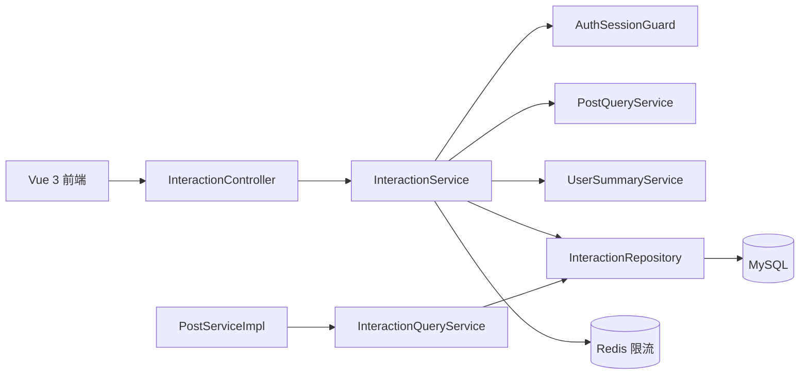

# C-53 互动与收藏开发方案

> 状态：初稿，待评审  
> 版本：1.0  
> 日期：2026-10-26  
> 依据：`docs/需求文档/互动与收藏PRD.md`、`docs/接口文档/接口清单.md`、现有 `post`、`auth`、`media`、`discovery` 模块及前端互动代码。

## 1. 方案摘要

本方案实现接口清单 3.4 的 D1～D9：点赞、取消点赞、收藏、取消收藏、评论列表、发表评论、回复评论、分享事件和我的收藏列表，并将真实互动字段接入动态详情与首页信息流。

核心决策：

1. 新增独立 `interaction` 业务模块，不把点赞、评论和收藏代码继续堆入 `post` 模块。
2. 点赞、收藏使用“关系表 + 唯一键”保证幂等；点赞数量采用动态表字段原子增减，避免每次读取都执行 `COUNT(*)`。
3. 评论使用一张自关联 `comments` 表，`parent_id IS NULL` 表示一级评论；只允许两级结构。
4. 分享只写统计事件，不参与页面主链路；失败由前端静默忽略。
5. 动态列表通过批量聚合查询互动数据，禁止 N+1 查询。
6. 所有写请求在 Service 层进行会话校验、动态可见性校验和限流，不能只依赖 Spring Security 路由规则。
7. 多表写入用现有 `TransactionTemplate`，保持与发布模块一致。

## 2. 现状分析

### 2.1 后端现状

当前后端已具备：

- `PostResponse` 的互动字段占位：`likeCount`、`likedByMe`、`bookmarkedByMe`、`commentCount`。
- `PostServiceImpl#toResponses` 的动态批量组装入口。
- `AuthSessionGuard`，可用于写操作会话有效性校验。
- `UserSummaryService`，可用于评论作者摘要批量查询。
- `ApiResponse`、`ApiException`、统一异常处理和 Redis 限流基础设施。
- MyBatis-Plus Mapper/Repository 分层和 `TransactionTemplate` 事务模式。

当前缺少：

- 互动数据表和数据库索引。
- 互动 Controller、DTO、Service、Repository。
- `PostService` 与 `InteractionQueryService` 的批量查询协作。
- `SecurityConfig` 对互动写接口和收藏列表的显式认证规则。
- 评论和收藏前端的后端真实数据联调。

### 2.2 前端现状

`C-53_fe` 已经有以下调用和消费逻辑：

- `setPostLike(postId, active)` 消费 `{ active, count }`。
- `setPostBookmark(postId, active)` 消费 `{ active }`。
- `getComments(postId)`、`createComment(postId, content)`、`createReply(commentId, content)`。
- `recordShare(postId, channel)`，异常被静默忽略。
- `getBookmarks({ limit, cursor })`，收藏页消费动态列表。
- `PostDetailView.vue` 已支持一级评论、二级回复、点赞、收藏和分享事件。

因此后端应优先兼容既有路径和字段，避免前端另起一套接口。

## 3. 目标架构



### 3.1 模块边界

```text
com.c53.modules.interaction
├── controller/InteractionController.java
├── dto/InteractionDtos.java
├── entity/LikeEntity.java
├── entity/BookmarkEntity.java
├── entity/CommentEntity.java
├── entity/ShareEventEntity.java
├── mapper/LikeMapper.java
├── mapper/BookmarkMapper.java
├── mapper/CommentMapper.java
├── mapper/ShareEventMapper.java
├── repository/InteractionRepository.java
├── service/InteractionService.java
├── service/InteractionQueryService.java
├── service/impl/InteractionServiceImpl.java
├── service/impl/InteractionQueryServiceImpl.java
└── support/InteractionRules.java
```

模块依赖：

```text
interaction → auth（AuthSessionGuard、UserSummaryService）
interaction → post（只读动态查询 Service，不直接注入 PostRepository）
interaction → common（响应、异常、限流、ID 生成）
post → interaction（InteractionQueryService，仅查询互动摘要）
```

约束：

- `interaction` 不直接注入 `PostRepository`，通过 `PostQueryService` 或新增只读接口确认动态公开状态。
- `post` 不直接注入 `interaction` 的 Mapper/Repository，只调用 `InteractionQueryService`。
- `interaction` 不修改动态正文、状态、媒体和话题计数。
- 动态删除后，互动模块通过查询条件隐藏关联数据；删除事务是否物理清理由后续清理任务决定。

## 4. 数据库设计

### 4.1 动态表新增计数字段

建议在 `posts` 表增加：

```sql
ALTER TABLE posts
    ADD COLUMN like_count BIGINT NOT NULL DEFAULT 0 COMMENT '点赞数',
    ADD COLUMN comment_count BIGINT NOT NULL DEFAULT 0 COMMENT '评论与回复总数';
```

实际执行必须使用幂等 DDL，避免 Spring SQL Init 在第二次启动时报字段已存在。推荐在脚本中查询 `information_schema.columns` 后动态执行 `ALTER TABLE`。

原因：

- Feed 和详情高频读取时直接读取计数，不执行实时聚合。
- 点赞/评论写入时通过 `GREATEST(0, count ± 1)` 原子更新。
- `like_count`、`comment_count` 是可重建派生数据；后续可增加离线对账任务。

### 4.2 点赞表 `post_likes`

```sql
CREATE TABLE IF NOT EXISTS post_likes (
    id         VARCHAR(40) CHARACTER SET ascii COLLATE ascii_bin NOT NULL,
    post_id    VARCHAR(40) CHARACTER SET ascii COLLATE ascii_bin NOT NULL,
    user_id    VARCHAR(40) CHARACTER SET ascii COLLATE ascii_bin NOT NULL,
    created_at DATETIME(3) NOT NULL DEFAULT CURRENT_TIMESTAMP(3),
    PRIMARY KEY (id),
    UNIQUE KEY uk_post_likes_post_user (post_id, user_id),
    KEY idx_post_likes_post_created (post_id, created_at),
    KEY idx_post_likes_user_created (user_id, created_at)
) ENGINE=InnoDB DEFAULT CHARSET=utf8mb4 COLLATE=utf8mb4_unicode_ci
 COMMENT='动态点赞关系';
```

唯一键保证同一用户只能点赞一次。

### 4.3 收藏表 `post_bookmarks`

```sql
CREATE TABLE IF NOT EXISTS post_bookmarks (
    id           VARCHAR(40) CHARACTER SET ascii COLLATE ascii_bin NOT NULL,
    post_id      VARCHAR(40) CHARACTER SET ascii COLLATE ascii_bin NOT NULL,
    user_id      VARCHAR(40) CHARACTER SET ascii COLLATE ascii_bin NOT NULL,
    bookmarked_at DATETIME(3) NOT NULL DEFAULT CURRENT_TIMESTAMP(3),
    PRIMARY KEY (id),
    UNIQUE KEY uk_post_bookmarks_post_user (post_id, user_id),
    KEY idx_post_bookmarks_user_time (user_id, bookmarked_at, post_id),
    KEY idx_post_bookmarks_post_user (post_id, user_id)
) ENGINE=InnoDB DEFAULT CHARSET=utf8mb4 COLLATE=utf8mb4_unicode_ci
 COMMENT='动态收藏关系';
```

收藏列表使用 `(user_id, bookmarked_at, post_id)` 索引实现稳定游标分页。

### 4.4 评论表 `comments`

```sql
CREATE TABLE IF NOT EXISTS comments (
    id          VARCHAR(40) CHARACTER SET ascii COLLATE ascii_bin NOT NULL,
    post_id     VARCHAR(40) CHARACTER SET ascii COLLATE ascii_bin NOT NULL,
    author_id   VARCHAR(40) CHARACTER SET ascii COLLATE ascii_bin NOT NULL,
    parent_id   VARCHAR(40) CHARACTER SET ascii COLLATE ascii_bin NULL,
    content     VARCHAR(1500) NOT NULL COMMENT '应用层限制 500 Unicode 码点',
    status      VARCHAR(16) CHARACTER SET ascii COLLATE ascii_bin NOT NULL DEFAULT 'VISIBLE'
                    COMMENT 'VISIBLE / DELETED / HIDDEN',
    created_at  DATETIME(3) NOT NULL DEFAULT CURRENT_TIMESTAMP(3),
    updated_at  DATETIME(3) NOT NULL DEFAULT CURRENT_TIMESTAMP(3)
                    ON UPDATE CURRENT_TIMESTAMP(3),
    deleted_at  DATETIME(3) NULL,
    PRIMARY KEY (id),
    KEY idx_comments_post_root_time (post_id, parent_id, created_at, id),
    KEY idx_comments_parent_time (parent_id, created_at, id),
    KEY idx_comments_author_time (author_id, created_at)
) ENGINE=InnoDB DEFAULT CHARSET=utf8mb4 COLLATE=utf8mb4_unicode_ci
 COMMENT='动态评论与二级回复';
```

MySQL 5.7 对 Unicode 码点长度不能单独依赖 `VARCHAR(500)`，因此列长度留出 UTF-8 字节余量，实际长度由 Java 规则校验。

### 4.5 分享事件表 `post_share_events`

```sql
CREATE TABLE IF NOT EXISTS post_share_events (
    id         VARCHAR(40) CHARACTER SET ascii COLLATE ascii_bin NOT NULL,
    post_id    VARCHAR(40) CHARACTER SET ascii COLLATE ascii_bin NOT NULL,
    user_id    VARCHAR(40) CHARACTER SET ascii COLLATE ascii_bin NOT NULL,
    channel    VARCHAR(16) CHARACTER SET ascii COLLATE ascii_bin NOT NULL
                   COMMENT 'WECHAT / QQ / DOUYIN',
    created_at DATETIME(3) NOT NULL DEFAULT CURRENT_TIMESTAMP(3),
    PRIMARY KEY (id),
    KEY idx_share_events_post_time (post_id, created_at),
    KEY idx_share_events_user_time (user_id, created_at)
) ENGINE=InnoDB DEFAULT CHARSET=utf8mb4 COLLATE=utf8mb4_unicode_ci
 COMMENT='动态分享统计事件';
```

分享事件不建立业务唯一键，允许统计同一用户的多次分享；通过限流保护写入量。

### 4.6 时间与 ID 约定

- 所有时间使用 UTC，Java 使用 `Instant`，数据库使用 `DATETIME(3)`。
- ID 使用 `IdGenerator.newId`：`lik_`、`bmk_`、`cmt_`、`shr_`。
- 不建外键，保持现有工程跨模块数据库约定；应用层校验动态和用户归属。

## 5. DTO 与 Service 设计

### 5.1 DTO

建议新增 `InteractionDtos.java`：

```java
public final class InteractionDtos {

    public record LikeResponse(boolean active, long count) {}

    public record BookmarkResponse(boolean active) {}

    public record CommentRequest(@NotBlank @Size(max = 500) String content) {}

    public record ShareEventRequest(@NotNull String channel) {}

    public record CommentView(
            String id,
            UserSummary author,
            String content,
            Instant createdAt,
            List<CommentView> replies,
            boolean repliesTruncated) {}

    public record CommentListResponse(
            List<CommentView> items,
            String nextCursor) {}

    public record BookmarkListResponse(
            List<PostResponse> items,
            String nextCursor) {}
}
```

说明：Java Bean Validation 的 `@Size` 不能准确表达 Unicode 码点限制，Service 层仍需使用 `content.codePointCount(0, content.length())` 二次校验。

### 5.2 查询接口

```java
public interface InteractionQueryService {

    record InteractionSummary(
            long likeCount,
            boolean likedByMe,
            boolean bookmarkedByMe,
            long commentCount) {}

    Map<String, InteractionSummary> findSummaries(
            Collection<String> postIds, String viewerId);
}
```

未登录时 `viewerId = null`，只查询公开计数，不查询用户关系。

### 5.3 业务接口

```java
public interface InteractionService {

    LikeResponse like(AuthPrincipal principal, String postId);

    LikeResponse unlike(AuthPrincipal principal, String postId);

    BookmarkResponse bookmark(AuthPrincipal principal, String postId);

    BookmarkResponse unbookmark(AuthPrincipal principal, String postId);

    CommentListResponse comments(AuthPrincipal principal, String postId,
                                 String cursor, int limit);

    CommentView createComment(AuthPrincipal principal, String postId,
                              CommentRequest request);

    CommentView createReply(AuthPrincipal principal, String commentId,
                            CommentRequest request);

    void share(AuthPrincipal principal, String postId, ShareEventRequest request);

    BookmarkListResponse bookmarks(AuthPrincipal principal,
                                   String cursor, int limit);
}
```

## 6. 核心流程

### 6.1 点赞流程

```text
Controller
  → requireActive(user)
  → requirePublishedPost(postId)
  → transaction
      INSERT IGNORE post_likes(post_id, user_id)
      若影响 1 行：UPDATE posts SET like_count = like_count + 1
      SELECT like_count
  → 返回 active=true/count
```

取消点赞：

```text
transaction
  → DELETE FROM post_likes WHERE post_id=? AND user_id=?
  → 若影响 1 行：UPDATE posts SET like_count = GREATEST(0, like_count - 1)
  → SELECT like_count
  → 返回 active=false/count
```

关键点：

- 插入关系和增加计数必须在同一事务。
- 唯一键冲突不能视为错误；再次查询当前计数并返回 `active=true`。
- 删除影响 0 行时保持 `active=false`，不减少计数。
- `like_count` 只允许通过条件更新修改。

### 6.2 收藏流程

```text
PUT /posts/{id}/bookmark
  → 会话校验
  → 动态公开校验
  → INSERT IGNORE post_bookmarks
  → 返回 active=true

DELETE /posts/{id}/bookmark
  → 会话校验
  → DELETE post_bookmarks
  → 返回 active=false
```

收藏不需要计数列。详情和 Feed 通过批量 `EXISTS` 查询当前用户关系。

### 6.3 评论创建流程

1. 校验登录会话和用户状态。
2. 规范化评论：换行统一、去首尾空白、拒绝控制字符。
3. 校验 1～500 个 Unicode 码点。
4. 查询动态，必须为 `PUBLISHED` 且未删除。
5. 检查评论权限配置；本期默认允许所有人。
6. 事务内插入评论并执行：

```sql
UPDATE posts
SET comment_count = comment_count + 1
WHERE id = ? AND status = 'PUBLISHED' AND deleted_at IS NULL;
```

7. 返回新评论，并通过 `UserSummaryService` 获取作者摘要。

### 6.4 回复创建流程

1. 校验登录和评论内容。
2. 查询父评论，必须存在、可见且 `parent_id IS NULL`。
3. 根据父评论的 `post_id` 校验动态仍然公开。
4. 事务内插入 `parent_id = 一级评论 ID` 的回复。
5. 原子增加 `posts.comment_count`。
6. 返回新回复，`replies=[]`。

### 6.5 评论列表流程

推荐查询分两步，避免一次连接返回大量重复作者数据：

1. 查询一级评论：

```sql
SELECT *
FROM comments
WHERE post_id = ?
  AND parent_id IS NULL
  AND status = 'VISIBLE'
  AND deleted_at IS NULL
ORDER BY created_at DESC, id DESC
LIMIT ?;
```

2. 根据一级评论 ID 集合批量查询回复：

```sql
SELECT *
FROM comments
WHERE parent_id IN (...)
  AND status = 'VISIBLE'
  AND deleted_at IS NULL
ORDER BY created_at ASC, id ASC;
```

3. 按父评论 ID 分组，限制每条最多 20 条回复。
4. 批量调用 `UserSummaryService.findByIds` 组装作者。
5. 返回 `{items, nextCursor}`。

评论列表不返回草稿、定时和已删除动态的评论。

### 6.6 分享事件流程

1. 校验登录会话。
2. 校验动态公开状态。
3. 解析 `channel` 为大写枚举。
4. 执行用户维度限流。
5. 插入 `post_share_events`。
6. 返回 204；异常记录日志并按产品约定不影响前端分享。若数据库不可用，接口返回统一错误，但前端仍静默忽略。

### 6.7 我的收藏流程

1. 校验登录会话。
2. 规范化 `limit`：默认 20，最大 50。
3. 解码游标 `{bookmarkedAt}|{postId}`。
4. 查询收藏关系并连接/批量读取仍公开的动态。
5. 使用现有 `PostService` 视图组装逻辑，补充真实互动字段。
6. 多查一条判断是否有下一页。
7. 返回 `nextCursor`。

游标查询条件：

```sql
WHERE user_id = ?
  AND (bookmarked_at < ?
       OR (bookmarked_at = ? AND post_id < ?))
ORDER BY bookmarked_at DESC, post_id DESC
LIMIT ?;
```

如果收藏关系对应的动态已删除，直接过滤；游标使用最后一个实际返回项生成，避免客户端出现空洞页。

## 7. 动态视图批量查询

### 7.1 组装位置

在 `PostServiceImpl#toResponses` 中：

```java
Map<String, InteractionSummary> interactions = interactionQueryService
        .findSummaries(postIds, principal == null ? null : principal.userId());
```

每条动态读取：

```java
InteractionSummary summary = interactions.getOrDefault(
        post.getId(), new InteractionSummary(0, false, false, post.getCommentCount()));
```

然后使用真实值构造 `PostResponse`。

### 7.2 查询策略

- 点赞计数优先读取 `posts.like_count`。
- 评论计数优先读取 `posts.comment_count`。
- 当前用户点赞状态：`post_likes WHERE user_id=? AND post_id IN (...)`。
- 当前用户收藏状态：`post_bookmarks WHERE user_id=? AND post_id IN (...)`。
- 多条动态必须使用 `IN` 批量查询并在内存中按 `postId` 组装。
- 游客不执行关系表查询，直接将两个布尔字段设为 `false`。

### 7.3 数据修复与对账

新增可选的离线校验 SQL：

```sql
SELECT p.id,
       p.like_count,
       COUNT(l.id) AS actual_like_count
FROM posts p
LEFT JOIN post_likes l ON l.post_id = p.id
GROUP BY p.id, p.like_count
HAVING p.like_count <> actual_like_count;
```

上线初期可每日运行对账；发现差异时以关系表聚合结果修复计数列。评论计数同理。

## 8. Controller 路由

```java
@RestController
@RequestMapping("/api/v1")
public class InteractionController {

    @PutMapping("/posts/{id}/like")
    ApiResponse<LikeResponse> like(...);

    @DeleteMapping("/posts/{id}/like")
    ApiResponse<LikeResponse> unlike(...);

    @PutMapping("/posts/{id}/bookmark")
    ApiResponse<BookmarkResponse> bookmark(...);

    @DeleteMapping("/posts/{id}/bookmark")
    ApiResponse<BookmarkResponse> unbookmark(...);

    @GetMapping("/posts/{id}/comments")
    ApiResponse<CommentListResponse> comments(...);

    @PostMapping("/posts/{id}/comments")
    ResponseEntity<ApiResponse<CommentView>> createComment(...);

    @PostMapping("/comments/{id}/replies")
    ResponseEntity<ApiResponse<CommentView>> createReply(...);

    @PostMapping("/posts/{id}/share-events")
    ResponseEntity<Void> share(...);

    @GetMapping("/me/bookmarks")
    ApiResponse<BookmarkListResponse> bookmarks(...);
}
```

建议 Controller 只做参数提取和状态码控制：

- 点赞、取消点赞、收藏、取消收藏、评论列表返回 200。
- 创建评论和回复返回 201。
- 分享成功返回 204。
- 不在 Controller 中拼 SQL 或实现业务幂等。

## 9. SecurityConfig 规则

在通用规则之前显式加入：

```java
.requestMatchers(HttpMethod.GET, "/api/v1/posts/*/comments").permitAll()
.requestMatchers(HttpMethod.PUT, "/api/v1/posts/*/like").authenticated()
.requestMatchers(HttpMethod.DELETE, "/api/v1/posts/*/like").authenticated()
.requestMatchers(HttpMethod.PUT, "/api/v1/posts/*/bookmark").authenticated()
.requestMatchers(HttpMethod.DELETE, "/api/v1/posts/*/bookmark").authenticated()
.requestMatchers(HttpMethod.POST, "/api/v1/posts/*/comments").authenticated()
.requestMatchers(HttpMethod.POST, "/api/v1/comments/*/replies").authenticated()
.requestMatchers(HttpMethod.POST, "/api/v1/posts/*/share-events").authenticated()
.requestMatchers(HttpMethod.GET, "/api/v1/me/bookmarks").authenticated()
```

注意：

- Spring 路由认证只是第一层，Service 必须再次调用 `AuthSessionGuard.requireActive`。
- 评论列表允许匿名，但仍由 Service 强制过滤动态公开状态。
- 如果项目已有更宽的 `/api/v1/posts/**` 规则，应确保精确互动规则不会被错误放行或覆盖。

## 10. 限流与安全

### 10.1 推荐限流

| 操作 | 维度 | 阈值 | Redis Key |
|---|---|---:|---|
| 点赞/取消点赞 | userId | 120 次/分钟 | `interaction:like:{userId}` |
| 收藏/取消收藏 | userId | 120 次/分钟 | `interaction:bookmark:{userId}` |
| 创建评论/回复 | userId | 30 次/分钟 | `interaction:comment:{userId}` |
| 评论列表 | IP | 120 次/分钟 | `interaction:comments:ip:{ip}` |
| 分享事件 | userId | 60 次/分钟 | `interaction:share:{userId}` |
| 我的收藏 | userId | 60 次/分钟 | `interaction:bookmarks:{userId}` |

阈值应通过 `InteractionProperties` 配置，不硬编码在 Controller。Redis 故障沿用现有限流器的 fail-open 策略并记录告警；数据库幂等和唯一键仍有效。

### 10.2 越权防护

- 所有写操作从认证主体取得 `userId`，不接受请求体中的 `userId`。
- 动态 ID、评论 ID 都必须经过 Service 查询和状态验证。
- 评论回复必须通过父评论的 `post_id` 反查动态，禁止跨动态挂接。
- 评论作者摘要只能返回公开字段，不返回邮箱、手机号和会话信息。
- 日志不记录评论全文、Token、签名 URL。

## 11. 前端改造方案

### 11.1 文件清单

| 文件 | 改造 |
|---|---|
| `C-53_fe/src/services/api.js` | 保留现有 D1～D9 方法，补充 `cursor` 传递和错误码处理 |
| `C-53_fe/src/App.vue` | 继续消费真实互动响应；收藏列表支持游标；评论错误态与重试 |
| `C-53_fe/src/components/posts/PostDetailView.vue` | 评论加载态、错误态、重试按钮、提交中状态 |
| `C-53_fe/src/components/feed/FeedView.vue` | 列表项使用真实点赞/收藏/评论字段，避免本地推算 |
| `C-53_fe/src/style.css` | 加载、禁用、评论错误态样式（如需要） |

### 11.2 兼容要求

现有 API 方法路径保持不变：

```js
setPostLike: (postId, active) => request(`/posts/${postId}/like`, {
  method: active ? 'PUT' : 'DELETE',
})
setPostBookmark: (postId, active) => request(`/posts/${postId}/bookmark`, {
  method: active ? 'PUT' : 'DELETE',
})
getComments: (postId, params) => request(`/posts/${postId}/comments${queryString(params)}`)
getBookmarks: (params) => request(`/me/bookmarks${queryString(params)}`)
```

前端不应将接口返回的 `{ active, count }` 当成增量；必须整体覆盖：

```js
const result = await api.setPostLike(post.id, next)
post.liked = Boolean(result?.active)
post.likes = Number(result?.count ?? 0)
```

## 12. 测试方案

### 12.1 单元测试

- `InteractionRulesTest`：空白、Unicode 码点、控制字符、500/501 边界。
- `InteractionServiceTest`：重复点赞、重复取消、重复收藏、非法回复层级。
- `InteractionQueryServiceTest`：批量动态、游客状态、登录用户状态。
- `CursorCodecTest`：收藏游标编码、解码和非法游标。
- `CommentAssemblerTest`：一级评论、回复分组、回复截断、作者摘要。

### 12.2 Repository/Mapper 测试

- 唯一键阻止重复点赞。
- 唯一键阻止重复收藏。
- 点赞删除影响行数正确。
- 原子计数不会小于 0。
- 评论按时间和 ID 稳定排序。
- 收藏列表游标无重复、无遗漏。
- 动态删除后互动查询不返回公开结果。

### 12.3 接口验收

```bash
# 游客可读评论
curl -s 'http://localhost:8080/api/v1/posts/pst_xxx/comments'

# 登录用户点赞
curl -i -X PUT \
  -H "Authorization: Bearer $TOKEN" \
  'http://localhost:8080/api/v1/posts/pst_xxx/like'

# 发表评论
curl -s -X POST \
  -H "Authorization: Bearer $TOKEN" \
  -H 'Content-Type: application/json' \
  -d '{"content":"这段观察很有启发。"}' \
  'http://localhost:8080/api/v1/posts/pst_xxx/comments'

# 查询收藏
curl -s \
  -H "Authorization: Bearer $TOKEN" \
  'http://localhost:8080/api/v1/me/bookmarks?limit=20'
```

### 12.4 必测场景

1. 游客读取评论成功，写操作全部返回 401。
2. 点赞两次只产生一条关系，计数只增加一次。
3. 两个请求并发取消点赞，最终计数只减少一次。
4. 同一动态被多个用户同时点赞，最终计数与关系记录数一致。
5. 收藏/取消收藏重复调用均返回 200 和正确状态。
6. 评论 500 个码点成功，501 个码点失败。
7. emoji、中文和组合字符按 Unicode 码点规则处理。
8. 回复一级评论成功，回复二级评论失败。
9. 其他动态的评论 ID 不能被挂接到当前动态。
10. 评论列表含二级回复且作者信息批量补齐。
11. 删除动态后 Feed、详情、评论和收藏列表都不再公开该动态。
12. 收藏游标翻页无重复、无遗漏。
13. Redis 限流不可用时请求仍可用并产生告警。
14. 分享记录接口失败时前端系统分享仍正常完成。
15. `/feed` 20 条动态只产生固定数量的互动查询，不产生 N+1。

## 13. 监控与运维

建议指标：

| 指标 | 类型 | 标签 |
|---|---|---|
| `c53.interaction.like` | Counter | `action`、`result` |
| `c53.interaction.bookmark` | Counter | `action`、`result` |
| `c53.interaction.comment` | Counter | `level`、`result` |
| `c53.interaction.share` | Counter | `channel`、`result` |
| `c53.interaction.duration` | Timer | `operation` |
| `c53.interaction.rate_limited` | Counter | `operation` |
| `c53.interaction.count_mismatch` | Counter | `type` |

告警建议：

- 互动写入错误率连续 5 分钟超过 1%。
- 点赞/评论计数对账差异超过 0.1%。
- 评论接口 P95 超过 500ms。
- 限流命中量异常增长。
- 分享事件写入失败率异常时只告警，不影响页面分享。

## 14. 排期与交付物

| 阶段 | 工作内容 | 交付物 | 预估 |
|---|---|---|---:|
| M0 | 评审接口契约、确认计数策略 | 决策记录、字段冻结 | 0.5 天 |
| M1 | DDL、Entity、Mapper、Repository | `interaction-schema.sql` 和数据层 | 1.5 天 |
| M2 | 点赞、收藏、批量互动查询 | D1～D4、PostResponse 真实字段 | 1.5 天 |
| M3 | 评论、回复、评论列表 | D5～D7、二级评论组装 | 2 天 |
| M4 | 分享、收藏列表 | D8～D9、游标分页 | 1 天 |
| M5 | 前端联调 | Feed、详情、收藏页 | 1.5 天 |
| M6 | 并发、限流、安全、验收 | 测试报告、监控指标、接口文档 | 1.5 天 |
| | **合计** | | **约 9 天** |

## 15. 风险与应对

| 风险 | 影响 | 应对 |
|---|---|---|
| 计数列与关系表不一致 | 点赞数/评论数展示错误 | 同事务原子更新 + 每日对账修复 |
| 高并发点赞产生重复计数 | 数据不一致 | 唯一键 + 依据影响行数增减 |
| 评论数量增长导致列表过大 | 响应变慢 | 一级评论分页 + 回复数量上限 + 批量查询 |
| 互动查询引入 N+1 | Feed P95 上升 | `postIds` 批量查询并在内存组装 |
| 动态删除后残留互动 | 隐私或数据泄露 | 查询强制关联公开动态；清理任务延后物理删除 |
| 评论审核未上线 | 不适宜内容公开 | 本期明确范围；后续增加审核状态与管理能力 |
| Redis 不可用 | 限流失效 | fail-open + 监控告警；数据库唯一键承担幂等 |
| 分享接口阻塞分享体验 | 用户无法完成分享 | 前端异步上报，失败静默忽略 |

## 16. 评审清单

- [ ] 确认新增 `post_likes`、`post_bookmarks`、`comments`、`post_share_events` 四张表。
- [ ] 确认 `posts.like_count`、`posts.comment_count` 计数列方案。
- [ ] 确认评论最大长度为 500 个 Unicode 码点。
- [ ] 确认只允许两级评论，不允许回复回复。
- [ ] 确认评论列表采用一级评论分页、回复批量返回。
- [ ] 确认收藏默认仅本人可见。
- [ ] 确认分享接口返回 204，前端失败静默忽略。
- [ ] 确认评论删除与审核不纳入本期。
- [ ] 确认互动限流阈值和 Redis fail-open 策略。
- [ ] 确认动态视图由 `PostService` 调用 `InteractionQueryService` 批量补充字段。
- [ ] 确认新增测试、对账任务和监控指标范围。
