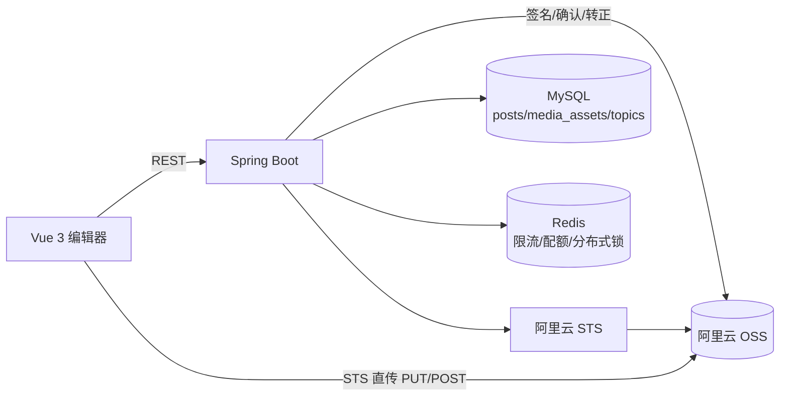

# C-53 发布功能开发方案（评审稿）

> 状态：初稿，待评审  
> 版本：1.0  
> 日期：2026-10-23  
> 输入：`docs/需求文档/发布功能PRD.md` v1.1、`docs/开发文档/登录模块开发方案.md` v1.0、`docs/后端工程目录规范.md`、现有 `C-53_be` / `C-53_fe` 代码  
> 说明：本文把 PRD 的需求语言转换为可执行的工程方案，包含模块划分、表结构、配置、类清单、核心流程、前端改造与测试计划。PRD 中 D1～D10 尚未拍板，本文按建议方案展开，并在第 2 章标注影响点。

## 1. 评审摘要

PRD 已明确「短动态 + 草稿 + 图片/视频 + 双通道上传 + 定时发布」的完整链路。本方案的关键工程结论如下：

1. **模块拆分**：新增 `com.c53.modules.post`（动态与草稿）、`com.c53.modules.media`（上传、OSS、STS、媒体生命周期）、`com.c53.modules.topic`（话题最小只读能力）。模块之间只通过 Service 接口协作，不注入对方 Repository。
2. **上传通道**：图片一律后端上传并重编码；视频 ≤10MB 后端上传，10MB～500MB 前端直传 OSS，>500MB 拒绝。阈值由 `GET /api/v1/media/config` 下发，不在前端写死。
3. **OSS 安全**：私有 Bucket + 专用 RAM Role + STS 会话策略（只允许写 `{env}/temp/{ownerId}/{uploadId}/*`）+ 确认转正 + 1 小时签名 URL。服务端不使用主账号 AK。
4. **数据一致性**：媒体先落临时路径，`confirm` 后转正式路径再绑定；动态发布只操作数据库，不阻塞在 OSS 调用上。写库使用 `TransactionTemplate`，OSS 调用放在事务外并做补偿。
5. **定时发布**：`@Scheduled` 每分钟扫描 + Redis 分布式锁 + 条件更新，天然幂等，多实例不会重复发布。
6. **幂等**：创建动态用 `(author_id, client_request_id)` 唯一索引兜底；草稿编辑用 `version` 乐观锁；`confirm` 与删除均幂等。
7. **前端**：新增 `ali-oss` 依赖用于分片直传；其余继续沿用现有 `api.js` + `App.vue` 集中状态与手写 CSS，不引入 UI 组件库。

评审时需要重点确认第 2 章的 D1～D10（PRD 遗留）与 D11～D17（本方案新增的工程决策）。

## 2. 需要评审确认的决策

### 2.1 承接 PRD 的决策

| 编号 | 决策点 | 本方案采用的默认值 | 若变更的影响 |
|---|---|---|---|
| D1 | OSS 资源归属 | 独立 Bucket、独立 RAM Role、`{env}` 前缀隔离 | 影响配置项与 STS 策略 |
| D2 | 话题必填与归属 | 发布/定时必填；草稿可空；`topics` 由新增的 `topic` 模块维护 | 若话题改为可选，去掉发布校验即可；若话题模块独立交付，删除 topic 模块 |
| D3 | 媒体读取方式 | 私有 Bucket + 1 小时签名 URL | 若改公共读/CDN，改 `ObjectStorage.signedUrl` 实现与安全章节 |
| D4 | 图片与视频互斥 | 互斥，一条动态只允许一种媒体类型 | 若允许混合，需改 `posts.media_type` 与前端编辑器 |
| D5 | 视频封面 | 本期不生成，浏览器展示首帧 | 后续加封面字段与截帧任务 |
| D6 | 草稿保留期与上限 | 90 天 / 每用户 50 篇 | 影响 `DraftCleanupJob` 与发布前校验 |
| D7 | 编辑历史 | 不保留，只更新 `edited_at` | 若保留需加版本表 |
| D8 | 定时最小提前量 | ≥5 分钟，最远 1 年，分钟级扫描 | 影响前端校验与调度频率 |
| D9 | 敏感词 | 本期只做基础词表同步校验，命中返回 `CONTENT_REJECTED` | 词表来源需产品提供 |
| D10 | 删除与媒体清理 | 软删不可恢复，数据保留 30 天后清理媒体与记录 | 影响清理任务与存储成本 |

### 2.2 本方案新增的工程决策

| 编号 | 决策点 | 建议方案 | 理由 |
|---|---|---|---|
| D11 | 模块拆分粒度 | `post`、`media`、`topic` 三个模块 | 媒体有独立的 OSS、STS、清理与限流逻辑，塞进 post 会让事务边界和安全策略纠缠 |
| D12 | 视频元数据解析 | 自研 `Mp4Probe`，通过 OSS Range 读取 MP4 Box，不下载整片 | 500MB 视频在确认阶段全量下载不可接受；Box 解析只读取 `moov`，通常 < 1MB |
| D13 | 作者信息聚合 | 在 auth 模块新增只读 `UserSummaryService`，post 模块调用 | 遵守「模块间不注入对方 Repository」；避免 SQL 直接 join 用户表 |
| D14 | 本地无 OSS 时如何开发 | 使用测试 Bucket；`ObjectStorage` 仅提供 OSS 实现 | 避免本地实现与生产语义分叉（签名 URL、分片、CopyObject 无法等价模拟） |
| D15 | 上传并发计数 | 用数据库统计 `INIT/UPLOADING` 记录，不用 Redis 计数 | 不会因 Redis 丢失或过期漂移，且与媒体状态天然一致 |
| D16 | 前端直传 SDK | `ali-oss@^6`，使用其分片、进度、断点与取消能力 | 自研 OSS SigV4 与分片协议成本高、易错 |
| D17 | 可观测性 | 本期加 `spring-boot-starter-actuator`（仅 health/info）+ 结构化日志；指标先落日志 | 完整 Prometheus 接入需要额外监控设施，放到运维阶段 |

## 3. 目标与范围

### 3.1 本期交付

- 后端 `post` / `media` / `topic` 三个模块，覆盖 PRD 第 9 章全部 15 个接口。
- `post-schema.sql` 幂等建表脚本，接入 Spring SQL Init。
- OSS 存储抽象、STS 凭证签发、直传确认转正、签名 URL。
- 图片魔数校验与重编码、视频容器/编码/时长校验。
- 草稿自动保存、乐观锁、发布/定时/编辑/删除、我的发布列表。
- Redis 限流与每日配额、幂等键、定时发布与清理任务。
- `SecurityConfig` 写接口认证规则。
- 前端发布编辑器、媒体上传、直传续传、定时设置、详情页编辑/删除。
- 单元测试、接口联调脚本与验收记录。

### 3.2 不在本期范围

- 视频转码、压缩、截帧、封面、HLS。
- 评论、点赞、收藏、转发、通知（本期只保证动态数据可被后续模块消费）。
- 内容审核后台、举报、管理员强制下线。
- 回收站恢复、发布历史版本、多端草稿实时同步。
- 公共读 CDN、防盗链、图片处理样式（OSS 图片处理服务）。

### 3.3 前置依赖

| 依赖 | 现状 | 交付前必须完成 |
|---|---|---|
| MySQL 8 / Redis 7 | 已可用 | 无 |
| 阿里云 OSS Bucket | 待开通 | 私有读、CORS、生命周期规则、测试用 AK |
| RAM Role + STS | 待配置 | 信任策略、最小权限策略、STS 端点连通性 |
| 前端构建 | 已可用 | 新增 `ali-oss` 依赖 |
| 话题数据 | 无 | 本期随 `topic` 模块建表并提供启动种子数据 |

## 4. 总体架构

### 4.1 组件关系



### 4.2 技术选型

| 层次 | 选型 | 说明 |
|---|---|---|
| Web | Spring MVC | 与现有认证模块一致 |
| 数据访问 | MyBatis-Plus BaseMapper + XML | 沿用 auth 模块的 Entity/Mapper/Repository 分层 |
| 事务 | `TransactionTemplate` | 与现有代码一致，不引入 `@Transactional` |
| 对象存储 | `aliyun-sdk-oss` 3.17.x | PutObject、CopyObject、HeadObject、签名 URL、分片中止 |
| STS | `aliyun-java-sdk-sts` 3.1.x | `AssumeRole` 签发 15 分钟临时凭证 |
| 图片处理 | `thumbnailator` 0.4.20 + `imageio-webp` 3.10.1 | 缩放、重编码、剥离 EXIF；WebP 解码 |
| 定时任务 | Spring `@Scheduled` | 分钟级扫描，Redis 锁保证单实例执行 |
| 限流 | Redis + Lua | 固定窗口计数，原子自增与过期 |
| 测试 | JUnit 5 + 真实 MySQL/Redis/OSS | 与认证模块的测试方式保持一致 |

> 引入新依赖前先执行 `mvn -o` 确认本地仓库可解析；若离线环境缺少依赖，需要先联网同步到本地仓库。

### 4.3 上传通道时序

**后端上传（图片、≤10MB 视频）**

```text
FE → POST /media/upload (multipart)
API: 认证 → 限流/配额 → 大小/魔数/MIME → 图片重编码或视频探测
API: INSERT media_assets (INIT) → UPDATE UPLOADING
API: PutObject 到正式路径
API: UPDATE READY（失败则 FAILED + 删除对象）
FE ← mediaId + 签名 URL
```

**前端直传（>10MB 视频）**

```text
FE → POST /media/upload-ticket
API: 校验 → INSERT media_assets (INIT) → STS AssumeRole → UPDATE UPLOADING
FE ← 临时凭证 + temp objectKey
FE → OSS multipartUpload（分片、进度、续传）
FE → POST /media/{id}/confirm
API: HeadObject + Mp4Probe → CopyObject 正式路径 → Delete temp → UPDATE READY
FE ← 正式媒体信息
```

## 5. 模块与包结构

### 5.1 后端目录

```text
com.c53
├── config
│   ├── MediaProperties.java
│   ├── PostProperties.java
│   └── SchedulingConfig.java          # @EnableScheduling + Clock Bean
├── common
│   └── ratelimit
│       ├── RedisRateLimiter.java      # Lua 固定窗口
│       └── RateLimitResult.java
├── modules
│   ├── post
│   │   ├── controller/PostController.java
│   │   ├── dto/PostDtos.java
│   │   ├── entity/PostEntity.java
│   │   ├── mapper/PostMapper.java
│   │   ├── repository/PostRepository.java
│   │   ├── service/PostService.java
│   │   ├── service/impl/PostServiceImpl.java
│   │   ├── job/ScheduledPublishJob.java
│   │   ├── job/DraftCleanupJob.java
│   │   └── support
│   │       ├── ContentRules.java      # 正文规范化与计数
│   │       └── CursorCodec.java       # 游标编码/解码
│   ├── media
│   │   ├── controller/MediaController.java
│   │   ├── dto/MediaDtos.java
│   │   ├── entity/MediaAssetEntity.java
│   │   ├── mapper/MediaAssetMapper.java
│   │   ├── repository/MediaAssetRepository.java
│   │   ├── service/MediaService.java
│   │   ├── service/impl/MediaServiceImpl.java
│   │   ├── storage/ObjectStorage.java
│   │   ├── storage/OssObjectStorage.java
│   │   ├── storage/StoredObject.java
│   │   ├── sts/StsTicketIssuer.java
│   │   ├── sts/StsCredentials.java
│   │   ├── job/MediaCleanupJob.java
│   │   └── support
│   │       ├── MediaValidator.java
│   │       ├── ImageProcessor.java
│   │       ├── Mp4Probe.java
│   │       └── ObjectKeys.java
│   ├── topic
│   │   ├── controller/TopicController.java
│   │   ├── dto/TopicDtos.java
│   │   ├── entity/TopicEntity.java
│   │   ├── mapper/TopicMapper.java
│   │   ├── repository/TopicRepository.java
│   │   └── service/TopicService.java + impl/TopicServiceImpl.java
│   └── auth                          # 仅新增两个只读接口
│       ├── service/UserSummaryService.java
│       └── service/AuthSessionGuard.java
└── security
    └── SecurityConfig.java            # 增加发布/上传路由规则
```

新增 Mapper 必须标注 `@Mapper`，因为启动类使用 `@MapperScan(annotationClass = Mapper.class)`。

### 5.2 模块依赖

```text
post  → media（MediaService 绑定/查询媒体）
post  → topic（TopicService 校验与计数）
post  → auth （UserSummaryService、AuthSessionGuard）
media → auth （AuthSessionGuard）
topic → 无
common ← 所有模块
```

约束：

- 不注入对方 Repository，不直接写对方的表。
- `TopicService.adjustPostCount`、`MediaService.bindToPost` 被 post 模块在**同一线程、同一事务**内调用，内部不再开启新事务。
- 跨模块调用只做本地方法调用，不发 HTTP。

## 6. 数据库设计

### 6.1 脚本与执行

新增 `C-53_be/src/main/resources/db/post/post-schema.sql`，并在配置中追加：

```yaml
spring:
  sql:
    init:
      schema-locations: classpath:db/auth/auth-schema-v2.sql,classpath:db/post/post-schema.sql
```

- 使用 `CREATE TABLE IF NOT EXISTS`，重复启动不报错。
- 字符集 `utf8mb4`，时间 `DATETIME(3)` 存 UTC。
- 不建外键，与认证模块保持一致。
- 脚本末尾写入开发用种子话题，使用 `INSERT IGNORE`，生产由运营导入。

### 6.2 `posts`

| 字段 | 类型 | 说明 |
|---|---|---|
| `id` | `VARCHAR(40) ascii_bin` PK | `pst_` + ULID |
| `author_id` | `VARCHAR(40) ascii_bin` | 作者 |
| `status` | `VARCHAR(16) ascii_bin` | `DRAFT/SCHEDULED/PUBLISHED/DELETED` |
| `content` | `TEXT` | 正文，保留 `\n` |
| `topic_id` | `VARCHAR(40) ascii_bin` NULL | 话题 |
| `media_type` | `VARCHAR(16) ascii_bin` NULL | `IMAGE/VIDEO` |
| `scheduled_at` | `DATETIME(3)` NULL | 计划时间 |
| `published_at` | `DATETIME(3)` NULL | 公开时间 |
| `edited_at` | `DATETIME(3)` NULL | 最近编辑 |
| `version` | `INT` | 乐观锁 |
| `client_request_id` | `VARCHAR(64) ascii_bin` NULL | 创建幂等键 |
| `created_at/updated_at` | `DATETIME(3)` | `updated_at` 自动更新 |
| `deleted_at` | `DATETIME(3)` NULL | 软删时间 |

索引：

| 名称 | 字段 | 用途 |
|---|---|---|
| `uk_posts_author_request` | `(author_id, client_request_id)` | 创建幂等；MySQL 允许多个 NULL |
| `idx_posts_author_status_updated` | `(author_id, status, updated_at)` | 我的草稿/定时列表 |
| `idx_posts_feed` | `(status, published_at, id)` | Feed 与详情排序 |
| `idx_posts_schedule` | `(status, scheduled_at)` | 定时扫描 |
| `idx_posts_topic_published` | `(topic_id, status, published_at)` | 话题聚合 |

### 6.3 `media_assets`

| 字段 | 类型 | 说明 |
|---|---|---|
| `id` | `VARCHAR(40) ascii_bin` PK | `med_` + ULID |
| `owner_id` | `VARCHAR(40) ascii_bin` | 上传者 |
| `media_type` | `VARCHAR(16)` | `IMAGE/VIDEO`（`TEXT` 预留） |
| `upload_mode` | `VARCHAR(16)` | `SERVER/DIRECT` |
| `storage_provider` | `VARCHAR(16)` | 固定 `OSS` |
| `bucket` | `VARCHAR(64)` NULL | Bucket 名 |
| `object_key` | `VARCHAR(512) ascii_bin` NULL | 正式对象 Key |
| `temp_object_key` | `VARCHAR(512) ascii_bin` NULL | 临时 Key |
| `mime` | `VARCHAR(64)` | `image/jpeg` 等 |
| `size_bytes` | `BIGINT` | 实际大小 |
| `width/height` | `INT` NULL | 像素 |
| `duration_ms` | `BIGINT` NULL | 视频时长 |
| `checksum` | `VARCHAR(128)` NULL | ETag |
| `post_id` | `VARCHAR(40)` NULL | 绑定的动态 |
| `sort_order` | `INT` | 展示顺序 |
| `status` | `VARCHAR(16)` | `INIT/UPLOADING/READY/BOUND/FAILED/DELETED` |
| `expires_at` | `DATETIME(3)` NULL | 凭证/临时对象过期 |
| `created_at/updated_at/deleted_at` | `DATETIME(3)` | 时间 |

索引：`(post_id, sort_order)`、`(owner_id, status)`、`(status, expires_at)`、`(post_id)`。

### 6.4 `topics`

| 字段 | 类型 | 说明 |
|---|---|---|
| `id` | `VARCHAR(40)` PK | `tpc_` + ULID |
| `name` | `VARCHAR(32)` | 唯一 |
| `status` | `VARCHAR(16)` | `ACTIVE/DISABLED` |
| `post_count` | `BIGINT` | 已发布动态数 |
| `created_at/updated_at` | `DATETIME(3)` | 时间 |

### 6.5 数据约定

- ID 全部复用 `IdGenerator.newId(prefix)`，新增前缀 `pst_`、`med_`、`tpc_`。
- 时间全部 `Instant` + UTC，接口输出 ISO 8601；Jackson 已配置 `write-dates-as-timestamps: false`。
- 多表写入使用 `TransactionTemplate`；OSS 调用不得放在事务内。
- 分页使用 `(published_at, id)` 或 `(updated_at, id)` 游标，禁止深分页。
- 签名 URL 不入库，只保存 `bucket + object_key`。

## 7. 配置与依赖

### 7.1 `pom.xml` 新增依赖

```xml
<dependency>
    <groupId>com.aliyun.oss</groupId>
    <artifactId>aliyun-sdk-oss</artifactId>
    <version>3.17.4</version>
</dependency>
<dependency>
    <groupId>com.aliyun</groupId>
    <artifactId>aliyun-java-sdk-sts</artifactId>
    <version>3.1.0</version>
</dependency>
<dependency>
    <groupId>net.coobird</groupId>
    <artifactId>thumbnailator</artifactId>
    <version>0.4.20</version>
</dependency>
<dependency>
    <groupId>com.twelvemonkeys.imageio</groupId>
    <artifactId>imageio-webp</artifactId>
    <version>3.10.1</version>
</dependency>
<dependency>
    <groupId>org.springframework.boot</groupId>
    <artifactId>spring-boot-starter-actuator</artifactId>
</dependency>
```

版本以团队私服/GitHub 可解析的最新稳定版为准，合入前执行一次完整构建确认。

### 7.2 `application.yml` 新增片段

```yaml
spring:
  servlet:
    multipart:
      max-file-size: 10MB
      max-request-size: 12MB
  sql:
    init:
      schema-locations: classpath:db/auth/auth-schema-v2.sql,classpath:db/post/post-schema.sql

management:
  endpoints:
    web:
      exposure:
        include: health,info

media:
  env: ${MEDIA_ENV:dev}
  endpoint: ${MEDIA_OSS_ENDPOINT:}
  region: ${MEDIA_OSS_REGION:oss-cn-hangzhou}
  bucket: ${MEDIA_OSS_BUCKET:}
  access-key-id: ${MEDIA_OSS_ACCESS_KEY_ID:}
  access-key-secret: ${MEDIA_OSS_ACCESS_KEY_SECRET:}
  role-arn: ${MEDIA_OSS_ROLE_ARN:}
  role-session-name: ${MEDIA_STS_SESSION_NAME:c53-upload}
  sts-endpoint: ${MEDIA_STS_ENDPOINT:sts.cn-hangzhou.aliyuncs.com}
  ticket-ttl: 15m
  part-size: 5MB
  signed-url-ttl: 1h
  temp-ttl: 24h
  server-upload-max-bytes: 10485760
  image:
    max-bytes: 10485760
    max-count: 9
    max-source-edge: 8000
    max-output-edge: 2048
    quality: 0.85
  video:
    max-bytes: 524288000
    max-duration: 300s
    max-width: 1920
    max-height: 1080
    max-fps: 60
  limits:
    ticket-per-minute: 5
    ticket-per-hour: 20
    upload-per-hour: 30
    concurrent-uploads: 3
    image-quota-per-day: 200
    video-quota-per-day: 10
    traffic-quota-per-day-bytes: 2147483648
    read-per-minute-per-ip: 120

post:
  schedule:
    min-lead: 5m
    max-lead: 365d
    scan-interval: 60s
    batch-size: 200
    lock-ttl: 55s
  limits:
    publish-per-hour: 10
    autosave-per-minute: 60
  draft:
    max-per-user: 50
    retention: 90d
  cleanup:
    delete-retention: 30d
    scan-interval: 10m
```

- `application.yml` 已被 `.gitignore` 排除；同步更新 `application.example.yml` 的占位版本，不写真实 AK。
- OSS 未配置时（`media.bucket` 为空）应用仍可启动，但媒体接口返回 `503 OSS_UNAVAILABLE`，便于纯文字本地开发。
- `MediaProperties`、`PostProperties` 使用 `@ConfigurationProperties` 并在启动类 `@EnableConfigurationProperties` 中补充注册。

## 8. OSS 与 STS 实现

### 8.1 存储抽象

```java
public interface ObjectStorage {
    void put(String objectKey, byte[] content, String contentType);
    void put(String objectKey, InputStream in, long length, String contentType);
    StoredObject head(String objectKey);
    byte[] readRange(String objectKey, long start, long end);
    void copy(String sourceKey, String targetKey, String contentType);
    void delete(String objectKey);
    String signedUrl(String objectKey, Duration ttl);
    void abortMultipartUpload(String objectKey, String uploadId);
}
```

- `OssObjectStorage` 由 `@ConditionalOnProperty(name = "media.bucket")` 激活，`MediaServiceImpl` 通过 `ObjectProvider<ObjectStorage>` 获取；缺失时统一抛 `OSS_UNAVAILABLE`。
- `copy` 使用 `CopyObjectRequest` + `ObjectMetadata` 覆盖 Content-Type，执行 `REPLACE` 元数据。
- `signedUrl` 使用 `generatePresignedUrl`，有效期取 `media.signed-url-ttl`。

### 8.2 对象 Key

```text
正式：{env}/{image|video}/{yyyy}/{MM}/{dd}/{ownerId}/{mediaId}.{ext}
临时：{env}/temp/{ownerId}/{uploadId}/source.{ext}
```

- `env` 来自 `media.env`，取值 `dev`、`test`、`prod`。
- `mediaId`、`uploadId` 均由服务端生成，扩展名由校验后的 MIME 决定。
- 客户端传入的 `fileName` 只用于日志，不参与路径拼接。

### 8.3 STS 签发

`StsTicketIssuer` 使用 `DefaultProfile` + `IAcsClient` 调用 `AssumeRole`：

| 参数 | 值 |
|---|---|
| `RoleArn` | `media.role-arn` |
| `RoleSessionName` | 当前 `userId` |
| `DurationSeconds` | 900 |
| `Policy` | 下述会话策略 |

```json
{
  "Version": "1",
  "Statement": [{
    "Effect": "Allow",
    "Action": [
      "oss:PutObject",
      "oss:InitiateMultipartUpload",
      "oss:UploadPart",
      "oss:CompleteMultipartUpload",
      "oss:AbortMultipartUpload"
    ],
    "Resource": ["acs:oss:*:*:{bucket}/{env}/temp/{ownerId}/{uploadId}/*"]
  }]
}
```

约束：

- 只授予写临时前缀的权限，不授予 `GetObject/ListObjects/DeleteObject/PutBucket*`。
- 策略 JSON 每次动态生成，策略长度必须小于 2048 字节。
- 凭证过期后前端必须重新申请；服务端不缓存凭证。
- RAM Role 的信任策略只允许后端账号 `sts:AssumeRole`。

### 8.4 确认与转正

`confirm` 步骤：

1. 校验媒体归属、状态为 `UPLOADING`、`expires_at` 未过期。
2. `HeadObject` 临时对象，校验存在、大小 ≤ 声明值且 ≤500MB。
3. `Mp4Probe` 通过 Range 读取 `moov`，校验 MP4 容器、`avc1/avc3` 视频轨、`mp4a` 音频轨（允许无音轨）、时长 ≤300s、分辨率 ≤1920×1080、平均帧率 ≤60。
4. 若请求带 `etag`，与 `HeadObject` 的 ETag 比较，不一致即失败。
5. 复制到正式路径 → 删除临时对象 → 更新 `object_key/size_bytes/duration_ms/width/height/status=READY`。
6. 任一步失败：删除临时对象、置 `FAILED`、返回 `MEDIA_CONFIRM_FAILED`。
7. 重复 `confirm` 时若已是 `READY/BOUND`，直接返回当前媒体，不再复制。

### 8.5 Bucket 配置清单

| 项 | 配置 |
|---|---|
| 读写权限 | 私有 |
| CORS | 允许站点域名；方法 `GET/HEAD/PUT/POST`；暴露 `ETag`、`x-oss-request-id`；MaxAge 3600 |
| 生命周期 | `{env}/temp/` 前缀 24 小时删除；未完成分片 24 小时中止 |
| 日志 | 开启访问日志 |
| 告警 | 异常流量、错误率告警 |
| 跨域回源 | 不配置 |

## 9. 接口实现清单

### 9.1 路由与 Service 映射

| 方法 | 路径 | 认证 | 成功码 | Controller 方法 | Service |
|---|---|---:|---:|---|---|
| GET | `/api/v1/media/config` | 否 | 200 | `MediaController.config` | `MediaService.config` |
| POST | `/api/v1/media/upload` | 是 | 201 | `MediaController.upload` | `MediaService.uploadServer` |
| POST | `/api/v1/media/upload-ticket` | 是 | 201 | `MediaController.ticket` | `MediaService.issueTicket` |
| POST | `/api/v1/media/{id}/confirm` | 是 | 200 | `MediaController.confirm` | `MediaService.confirm` |
| GET | `/api/v1/media/{id}` | 是 | 200 | `MediaController.get` | `MediaService.get` |
| DELETE | `/api/v1/media/{id}` | 是 | 204 | `MediaController.delete` | `MediaService.delete` |
| POST | `/api/v1/posts` | 是 | 201/200 | `PostController.create` | `PostService.create` |
| GET | `/api/v1/posts/{id}` | 可选 | 200 | `PostController.get` | `PostService.get` |
| PATCH | `/api/v1/posts/{id}` | 是 | 200 | `PostController.update` | `PostService.update` |
| POST | `/api/v1/posts/{id}/publish` | 是 | 200 | `PostController.publish` | `PostService.publish` |
| POST | `/api/v1/posts/{id}/schedule` | 是 | 200 | `PostController.schedule` | `PostService.schedule` |
| POST | `/api/v1/posts/{id}/cancel-schedule` | 是 | 200 | `PostController.cancelSchedule` | `PostService.cancelSchedule` |
| DELETE | `/api/v1/posts/{id}` | 是 | 204 | `PostController.delete` | `PostService.delete` |
| GET | `/api/v1/me/posts` | 是 | 200 | `PostController.myPosts` | `PostService.myPosts` |
| GET | `/api/v1/topics/trending` | 否 | 200 | `TopicController.trending` | `TopicService.trending` |

统一使用 `ApiResponse.ok(data)`；201/204 与幂等重复提交的 200 由 Controller 用 `ResponseEntity` 控制。

### 9.2 请求与响应模型

`PostDtos`：

```java
record CreatePostRequest(
        @Size(max = 600) String content,
        String topicId,
        List<String> mediaIds,
        List<String> imageIds,      // 兼容旧字段
        String status,              // DRAFT / PUBLISHED / SCHEDULED，缺省 PUBLISHED
        Instant scheduledAt,
        @Size(max = 64) String clientRequestId) {}

record UpdatePostRequest(
        String content, String topicId, List<String> mediaIds,
        @NotNull Integer version) {}

record ScheduleRequest(@NotNull Instant scheduledAt) {}

record PostResponse(
        String id, UserSummary author, TopicSummary topic,
        String content, String mediaType, List<MediaView> media,
        String status, Instant scheduledAt, Instant publishedAt,
        Instant editedAt, Instant createdAt, int version,
        boolean ownedByMe) {}
```

`MediaDtos`：

```java
record UploadTicketRequest(
        String fileName, String contentType,
        @NotNull Long sizeBytes, @NotNull String mediaType) {}

record TicketResponse(
        String mediaId, String uploadId,
        String accessKeyId, String accessKeySecret, String securityToken,
        Instant expiration, String region, String endpoint,
        String bucket, String objectKey, long partSizeBytes, String status) {}

record ConfirmRequest(String etag, Long sizeBytes) {}

record MediaView(
        String mediaId, String mediaType, String url,
        Integer width, Integer height, Long durationMs,
        Long sizeBytes, int sortOrder) {}
```

- `mediaIds` 与 `imageIds` 同时存在时以 `mediaIds` 为准；`imageIds` 仅做兼容。
- 所有时间是 `Instant`，输出 ISO 8601。
- `url` 是 1 小时签名地址，不落库。

### 9.3 错误码

沿用 `ApiException` 与 `GlobalExceptionHandler`，新增：

| HTTP | code | 触发点 |
|---:|---|---|
| 400 | `CONTENT_EMPTY` / `CONTENT_TOO_LONG` | 发布正文为空/超长 |
| 400 | `INVALID_SCHEDULE_TIME` | 定时时间过近、过远、缺时区 |
| 400 | `MEDIA_TYPE_MISMATCH` | 图片视频混用、类型不符 |
| 403 | `FORBIDDEN` | 非作者编辑/删除 |
| 404 | `POST_NOT_FOUND` / `MEDIA_NOT_FOUND` / `TOPIC_NOT_FOUND` | 不存在或无权查看 |
| 409 | `VERSION_CONFLICT` | 草稿并发编辑 |
| 409 | `INVALID_STATUS_TRANSITION` | 非法状态迁移 |
| 409 | `MEDIA_NOT_READY` | 绑定未就绪媒体 |
| 413 | `PAYLOAD_TOO_LARGE` | 超过上传上限 |
| 415 | `UNSUPPORTED_MEDIA_TYPE` | 魔数或白名单不符 |
| 422 | `MEDIA_INVALID` / `MEDIA_CONFIRM_FAILED` / `VIDEO_TOO_LONG` | 媒体校验失败 |
| 422 | `CONTENT_REJECTED` | 命中敏感词 |
| 429 | `RATE_LIMITED` | 限流命中，`details.retryAfter` |
| 503 | `OSS_UNAVAILABLE` | OSS/STS 不可用 |
| 504 | `UPLOAD_TICKET_EXPIRED` | 凭证或临时对象过期 |

`GlobalExceptionHandler` 需要补充两个异常映射：

- `MaxUploadSizeExceededException` → 413 `PAYLOAD_TOO_LARGE`。
- `MultipartException` → 400 `VALIDATION_ERROR`。

## 10. 核心流程设计

### 10.1 创建动态（草稿 / 立即发布 / 定时）

1. 校验登录会话（`AuthSessionGuard.requireActive`）。
2. 规范化正文：`\r\n`、`\r` 转 `\n`，连续 3 个以上换行折叠为 1 个空行，去首尾空白，拒绝控制字符（`\n`、`\t` 除外）。
3. 按 `status` 校验：
   - `DRAFT`：正文可为空，话题可空。
   - `PUBLISHED`：正文 1～600 码点，话题必填且 `ACTIVE`。
   - `SCHEDULED`：同 `PUBLISHED`，且 `scheduledAt` 在 `[now+5min, now+1y]`。
4. 媒体校验（`MediaService.prepareBinding`）：数量、类型、归属、状态 `READY`、未被绑定、图片/视频互斥。
5. 事务内执行：
   - `INSERT posts`；
   - `UPDATE media_assets SET post_id=?, sort_order=?, status='BOUND' WHERE id=? AND owner_id=? AND status='READY' AND post_id IS NULL`，逐条执行，影响行数必须为 1；
   - `PUBLISHED` 时 `TopicService.adjustPostCount(+1)`。
6. 唯一键冲突：在事务外捕获 `DuplicateKeyException`，按 `(author_id, client_request_id)` 查询并返回已存在动态，HTTP 200。
7. 返回 `PostResponse`，媒体通过 `MediaService.listByPost` 补充签名 URL。

> `clientRequestId` 为空时不参与幂等，允许创建多条。

### 10.2 草稿自动保存与乐观锁

前端触发：停止输入 3 秒、持续输入每 15 秒最多一次、媒体确认完成、话题变更、手动保存。

```sql
UPDATE posts
   SET content = ?, topic_id = ?, media_type = ?, version = version + 1,
       edited_at = CASE WHEN status = 'PUBLISHED' THEN ? ELSE edited_at END
 WHERE id = ? AND author_id = ? AND version = ? AND status <> 'DELETED' AND deleted_at IS NULL
```

- 影响 1 行：成功，返回新 `version`。
- 影响 0 行：查记录。不存在或已删除 → 404；作者不符 → 403；否则 409 `VERSION_CONFLICT`，`details` 带服务端当前 `version`。
- 媒体差异：先解绑移除项（`post_id=NULL, status='READY'`），再绑定新增项，均在事务内。
- 草稿保存不做敏感词拦截；发布时统一拦截。

### 10.3 立即发布草稿

`POST /posts/{id}/publish`：

1. 读取并校验作者（非作者 403，不存在 404）。
2. 只允许 `DRAFT`，其他状态返回 409 `INVALID_STATUS_TRANSITION`。
3. 重新校验正文、话题、媒体（草稿阶段可能不完整）。
4. 条件更新：

```sql
UPDATE posts SET status='PUBLISHED', published_at=?, version=version+1
 WHERE id=? AND author_id=? AND status='DRAFT' AND deleted_at IS NULL
```

5. 同一事务内 `TopicService.adjustPostCount(+1)`。
6. 返回更新后的动态。

### 10.4 定时发布

**设置/改期** `POST /posts/{id}/schedule`：

- 允许 `DRAFT`、`SCHEDULED`。
- 校验 `scheduledAt` 范围与正文、话题、媒体。
- `UPDATE posts SET status='SCHEDULED', scheduled_at=?, version=version+1 WHERE id=? AND author_id=? AND status IN ('DRAFT','SCHEDULED')`。
- 话题计数在发布时增加，设置定时时不增加。

**取消** `POST /posts/{id}/cancel-schedule`：

- 只允许 `SCHEDULED`，置回 `DRAFT` 并清空 `scheduled_at`。

**调度任务** `ScheduledPublishJob`：

```text
每分钟触发：
  slot = 当前分钟
  SET post:schedule:lock:{slot} NX PX 55000  // 抢不到直接返回
  SELECT id FROM posts
   WHERE status='SCHEDULED' AND scheduled_at <= now AND deleted_at IS NULL
   ORDER BY scheduled_at LIMIT 200
  逐条事务：
    UPDATE posts SET status='PUBLISHED', published_at=scheduled_at, version=version+1
     WHERE id=? AND status='SCHEDULED' AND deleted_at IS NULL
    若影响 1 行 → TopicService.adjustPostCount(+1)
```

- 失败单条不影响其他记录，保持 `SCHEDULED` 等下一轮。
- 使用统一 `Clock` 注入时间，便于测试。
- 日志输出 `postId`、计划时间、实际时间、延迟毫秒。

### 10.5 编辑已发布内容

- `PATCH /posts/{id}`，仅作者。
- 状态保持 `PUBLISHED`，更新 `edited_at`。
- 若更换话题：同事务内旧话题 `-1`、新话题 `+1`。
- 移除的媒体解绑为 `READY`，由清理任务按保留期回收。
- 不允许通过 `PATCH` 改变 `status`、作者、创建时间。

### 10.6 删除

- 仅作者；`DRAFT/SCHEDULED/PUBLISHED` 均允许。
- 事务内：

```sql
UPDATE posts SET status='DELETED', deleted_at=?, version=version+1
 WHERE id=? AND author_id=? AND status<>'DELETED' AND deleted_at IS NULL;

UPDATE media_assets SET status='DELETED', deleted_at=?
 WHERE post_id=? AND status='BOUND';
```

- `PUBLISHED` 删除时 `TopicService.adjustPostCount(-1)`。
- 重复删除返回 204，不再改数据。
- 立即从 Feed/详情/个人主页消失；他人的详情请求返回 404。

### 10.7 我的发布列表

- `GET /me/posts?status=&cursor=&limit=`，`limit` 默认 20，最大 50。
- 已发布：`ORDER BY published_at DESC, id DESC`。
- 草稿/定时：`ORDER BY updated_at DESC, id DESC`。
- 游标编码为 URL-safe Base64：`{时间戳}|{id}`；查询使用行比较：

```sql
WHERE (published_at, id) < (?, ?)
```

- 响应 `{items, nextCursor}`；`nextCursor` 为空表示结束。
- 列表项不返回完整正文，返回 `summary`（前 120 码点）。

### 10.8 媒体状态流转

```text
服务端上传：INIT → UPLOADING → READY → BOUND
直传：      INIT → UPLOADING →（confirm）→ READY → BOUND
失败：      INIT/UPLOADING → FAILED
删除：      READY/BOUND → DELETED
```

- 只有 `READY` 可绑定；`BOUND` 只能被当前动态复用。
- `EXPIRED` 通过 `expires_at` 判断，不单独设状态；清理任务把过期的 `INIT/UPLOADING` 置 `FAILED`。

## 11. 媒体校验与处理

### 11.1 图片

| 项 | 处理 |
|---|---|
| 魔数 | JPEG `FF D8 FF`、PNG `89 50 4E 47 0D 0A 1A 0A`、WebP `RIFF....WEBP` |
| 解码 | `ImageIO` + TwelveMonkeys WebP 插件 |
| 尺寸 | 单边 ≤8000px，超限拒绝 |
| 重编码 | 有 alpha 的 PNG 输出 PNG；JPEG/WebP 输出 JPEG，白底铺底 |
| 缩放 | 长边 ≤2048px |
| 质量 | JPEG 0.85 |
| 元数据 | 重新编码天然剥离 EXIF/GPS |
| 输出 MIME | `image/jpeg` 或 `image/png`，扩展名同步 |

- 拒绝 SVG、GIF、HEIC、伪造扩展名。
- 声明大小 ≤10MB；Spring 层 `max-file-size` 兜底，超出返回 413。
- 图片禁止直传，保证服务端一定有机会重编码。

### 11.2 视频

| 项 | 处理 |
|---|---|
| 容器 | MP4，第 4～7 字节为 `ftyp`，brand 属于 `isom/iso2/mp41/mp42/avc1` |
| 视频编码 | `avc1` / `avc3`（H.264），拒绝 H.265 |
| 音频编码 | `mp4a`（AAC）或无音轨 |
| 时长 | ≤300 秒 |
| 分辨率 | ≤1920×1080 |
| 帧率 | 平均 ≤60fps |
| 大小 | 服务端通道 ≤10MB；直传 10MB～500MB；>500MB 拒绝 |
| 处理 | 仅存原片，不转码、不压缩、不截帧 |

`Mp4Probe` 实现要点：

- 顺序读取 Box 头（8/16 字节），递归进入 `moov`、`trak`、`mdia`、`minf`、`stbl`。
- 直接上传场景通过 `ObjectStorage.readRange` 读取：先读文件头定位 `moov` 偏移，再 Range 读取该 Box，总读取量上限 8MB。
- 服务端上传直接读取本地临时文件。
- 解析 `mvhd` 拿 timescale/duration，`hdlr` 判断 `vide/soun`，`stsd` 判断编码，`tkhd` 拿宽高（16.16 定点），`stts` 估算平均帧率。
- 解析失败视为媒体不合法，拒绝入库。

### 11.3 后端上传落库顺序

1. 校验请求、限流、配额、并发。
2. `INSERT media_assets`（`INIT`）→ `UPDATE UPLOADING`。
3. 写入临时文件（`Files.createTempFile`），图片重编码 / 视频探测。
4. `PutObject` 正式路径。
5. `UPDATE READY`，写 `size_bytes/width/height/duration_ms`。
6. 任一步失败：删除 OSS 对象（若已写入），`UPDATE FAILED`，返回对应错误码。
7. 临时文件在 `finally` 中删除。

## 12. 限流、配额与幂等

### 12.1 Redis Key

| Key | 限制 | TTL |
|---|---|---|
| `post:ticket:{userId}:m` | 5 次/分钟 | 60s |
| `post:ticket:{userId}:h` | 20 次/小时 | 1h |
| `post:upload:{userId}:h` | 30 次/小时 | 1h |
| `post:quota:image:{userId}:{yyyyMMdd}` | 200/天 | 至次日 |
| `post:quota:video:{userId}:{yyyyMMdd}` | 10/天 | 至次日 |
| `post:quota:traffic:{userId}:{yyyyMMdd}` | 2GB/天 | 至次日 |
| `post:publish:{userId}:h` | 10 次/小时 | 1h |
| `post:autosave:{userId}:m` | 60 次/分钟 | 60s |
| `post:read:{ip}:m` | 120 次/分钟 | 60s |
| `post:schedule:lock:{slot}` | 分布式锁 | 55s |
| `post:cleanup:lock` / `post:draft:cleanup:lock` | 清理任务锁 | 按任务周期 |

- 计数使用 Lua 完成 `INCR + PEXPIRE`，保证原子性。
- 超限返回 429，`details` 带 `retryAfter` 秒数。
- Redis 故障时 fail-open 并 `WARN` 日志；发布幂等由数据库唯一键兜底，上传由 STS 前缀和确认校验兜底。
- 并发上传数用数据库统计：

```sql
SELECT COUNT(*) FROM media_assets
 WHERE owner_id=? AND status IN ('INIT','UPLOADING')
```

  超过 3 返回 429。

### 12.2 幂等

| 场景 | 机制 |
|---|---|
| 创建动态 | `(author_id, client_request_id)` 唯一索引 |
| 草稿保存 | `version` 乐观锁 |
| 直传确认 | 状态判断 + 已 `READY` 直接返回 |
| 删除 | 已删除直接 204 |
| 定时发布 | 条件更新 |
| 凭证申请 | 每次生成新 `uploadId`，靠限流约束 |

## 13. 权限与安全

### 13.1 `SecurityConfig` 变更

在 `anyRequest().permitAll()` 之前追加：

```java
.requestMatchers(HttpMethod.GET, "/api/v1/media/config", "/api/v1/topics/**").permitAll()
.requestMatchers(HttpMethod.GET, "/api/v1/posts/**").permitAll()
.requestMatchers("/api/v1/posts/**", "/api/v1/media/**").authenticated()
```

- `GET /api/v1/media/{id}` 需要认证，放在 `authenticated()` 规则内，不要被通配放行覆盖。
- 公开 GET 接口仍然经过 `JwtAuthenticationFilter`；携带有效 Token 时 `@AuthenticationPrincipal` 有值，用于判断作者可见性。
- 未登录访问写接口返回统一 401。

### 13.2 Service 层校验

- 所有写操作先调用 `AuthSessionGuard.requireActive(userId, sessionId)`，防止 JWT 未过期但会话已撤销。
- 资源归属与可见性分开：
  - 非作者访问草稿/定时 → 404。
  - 非作者编辑/删除 → 403。
- 媒体绑定必须校验 `owner_id`，禁止引用他人媒体。

### 13.3 内容与日志安全

- 正文按纯文本处理，前端使用插值；后端不解析 HTML。
- 拒绝 `\u0000` 等控制字符。
- 日志不记录正文全文、STS 密钥、签名 URL、视频二进制。
- 结构化日志字段：`requestId`、`userId`、`postId`、`mediaId`、`uploadMode`、`status`、`durationMs`、`errorCode`。
- OSS 密钥只从环境变量读取，不写入仓库。

## 14. 前端改造方案

### 14.1 依赖与模块

- `package.json` 增加 `ali-oss@^6`。
- 新增 `src/services/upload.js`：封装媒体配置、服务端上传、直传、续传、取消。
- 现有 `src/services/api.js` 增加以下方法：

```js
getMediaConfig: () => request('/media/config', {}, false),
uploadMedia: (formData) => request('/media/upload', { method: 'POST', body: formData }),
requestUploadTicket: (body) => request('/media/upload-ticket', { method: 'POST', body: JSON.stringify(body) }),
confirmMedia: (id, body) => request(`/media/${id}/confirm`, { method: 'POST', body: JSON.stringify(body) }),
getMedia: (id) => request(`/media/${id}`),
deleteMedia: (id) => request(`/media/${id}`, { method: 'DELETE' }),
updatePost: (id, body) => request(`/posts/${id}`, { method: 'PATCH', body: JSON.stringify(body) }),
publishPost: (id) => request(`/posts/${id}/publish`, { method: 'POST' }),
schedulePost: (id, scheduledAt) => request(`/posts/${id}/schedule`, { method: 'POST', body: JSON.stringify({ scheduledAt }) }),
cancelSchedule: (id) => request(`/posts/${id}/cancel-schedule`, { method: 'POST' }),
deletePost: (id) => request(`/posts/${id}`, { method: 'DELETE' }),
```

- `createPost` 保持现有签名，body 扩展 `status`、`scheduledAt`、`mediaIds`、`clientRequestId`。

### 14.2 直传实现

```js
const client = new OSS({
  region, endpoint, bucket,
  accessKeyId, accessKeySecret, stsToken: securityToken, secure: true,
})
const checkpointKey = `c53-upload:${mediaId}`
const checkpoint = JSON.parse(localStorage.getItem(checkpointKey) || 'null')
const result = await client.multipartUpload(objectKey, file, {
  partSize: partSizeBytes,
  checkpoint,
  progress: (p) => onProgress(p),
})
localStorage.removeItem(checkpointKey)
await api.confirmMedia(mediaId, { etag: result.etag, sizeBytes: file.size })
```

- 每上传完一个分片把 checkpoint 写回 localStorage，刷新后可继续。
- 取消时调用 SDK 的取消方法并 `DELETE /media/{id}`，同时由后端中止分片。
- 凭证过期（`expiration`）时提示重新申请，不复用旧凭证。
- 上传前用 `video/mp4` 元数据读取校验时长、分辨率，减少无效上传。

### 14.3 页面与状态

| 文件 | 改造内容 |
|---|---|
| `src/App.vue` | 发布会话状态：`id/version/content/topicId/mediaIds/status/scheduledAt/clientRequestId/saveState`；自动保存防抖与重试；发布/定时/取消/删除动作；媒体上传编排 |
| `src/components/feed/FeedView.vue` | 字数与码点计数保持一致；图片选择、预览、拖拽排序、删除；视频选择与进度；定时入口；保存状态提示 |
| `src/components/feed/MediaUploader.vue`（新增） | 图片/视频选择、上传队列、进度、失败重试、互斥提示 |
| `src/components/feed/ScheduleDialog.vue`（新增） | 时间选择、本地时区提示、≥5 分钟校验 |
| `src/components/posts/PostDetailView.vue` | 作者操作（编辑/删除）、`<video controls preload="metadata">`、已编辑标识、删除二次确认 |
| `src/style.css` | 编辑器、媒体网格、进度条、状态标签样式 |

- 草稿本地兜底 key：`c53-draft:{clientRequestId}`，保存正文、话题、媒体 ID、版本。
- 409 冲突时提供「载入最新 / 覆盖保存」；覆盖保存带服务端最新 `version` 重试。
- 发布成功后清空编辑态与本地草稿，切换到「最新发布」。
- 未登录点击发布跳转登录，登录后回跳并恢复编辑内容。

## 15. 测试方案

### 15.1 分层

| 层级 | 内容 |
|---|---|
| 单元测试 | 正文规范化与码点计数、定时时间校验、对象 Key 生成、STS 策略 JSON、游标编解码、媒体数量/类型校验 |
| 媒体测试 | 图片重编码后无 EXIF、尺寸与质量符合预期；`Mp4Probe` 对合法/非法样本的判定 |
| Repository 测试 | 唯一键、乐观锁、条件更新、游标分页、状态筛选 |
| 接口联调 | 真实 MySQL、Redis、测试 OSS Bucket 全链路 |
| 并发测试 | 同一 `clientRequestId` 并发创建、同一版本并发保存、多实例调度 |
| 故障测试 | OSS 不可用、STS 失败、Redis 不可用、数据库唯一键冲突 |
| 前端 | 上传进度、续传、取消、409 处理、定时校验 |

### 15.2 必测场景

- 纯文字草稿 → 发布 → 详情与列表可见。
- 正文仅空白、601 码点、emoji 计数。
- 双击发布、断网重试只产生一条动态。
- 草稿并发保存：后提交者 409，带当前版本。
- 图片 9 张上限、第 10 张拒绝；图片与视频混用拒绝。
- 图片超过 10MB 拒绝；视频 10MB 边界分别落入服务端与直传通道。
- 直传凭证过期、路径越权、非 MP4、超时长、超分辨率拒绝。
- 未确认媒体不能绑定；重复确认幂等。
- 使用他人媒体 ID 返回 404/422。
- 定时到点发布，延迟 ≤60 秒；取消后回到草稿且内容保留。
- 多实例部署同一条定时动态只发布一次。
- 删除后 Feed、详情、个人主页不可见；重复删除 204。
- 非作者访问草稿 404，编辑已发布内容 403。
- 限流命中返回 429 且带 `retryAfter`。
- Redis 宕机：限流放行、发布仍幂等、上传确认仍安全。
- OSS 未配置：纯文字发布正常，媒体接口 503。
- 日志不含正文全文、STS 密钥、签名 URL。

### 15.3 验收命令

```bash
cd C-53_be && mvn test
cd C-53_fe && npm run build
```

- `post-schema.sql` 在空库执行成功，重复执行不报错。
- 新增接口全部可在 Swagger（springdoc）或 curl 脚本中调通。
- 500MB 视频直传期间应用服务器 CPU、内存与出口带宽无明显上升。

## 16. 排期与交付物

| 阶段 | 工作 | 人天 | 交付物 |
|---|---|---:|---|
| M0 | 评审 D1～D17、开通 OSS/RAM/STS、准备测试 Bucket | 1.5 | 决策记录、OSS 配置清单 |
| M1 | `post-schema.sql`、Entity/Mapper/Repository、配置类、SecurityConfig | 2 | 数据层与安全规则 |
| M2 | 动态创建、草稿、乐观锁、发布、编辑、删除、我的列表 | 3 | 文字发布闭环 |
| M3 | 后端上传、图片重编码、媒体绑定、签名 URL | 2 | 小文件上传能力 |
| M4 | STS 签发、直传确认、Mp4Probe、转正、清理任务 | 4 | 大文件直传能力 |
| M5 | 定时发布、分布式锁、草稿与媒体清理任务 | 1.5 | 定时与清理能力 |
| M6 | 限流、配额、幂等与故障降级 | 1 | 保护能力 |
| M7 | 前端编辑器、上传组件、定时弹层、详情页操作 | 4 | 前后端联调版本 |
| M8 | 联调、安全测试、压测、验收与文档 | 2.5 | 验收版本 |
| 缓冲 | OSS 配置、网络、评审返工 | 2 | — |
| **合计** |  | **23.5** | 约 23～24 人天 |

### 交付物清单

- `C-53_be` 三模块实现与测试。
- `C-53_be/src/main/resources/db/post/post-schema.sql`。
- `application.example.yml` 中新增配置占位。
- `C-53_fe` 发布与上传改造。
- OSS 配置说明（Bucket、CORS、生命周期、RAM Role、STS）。
- 接口联调脚本与验收记录。

## 17. 风险

| 风险 | 影响 | 应对 |
|---|---|---|
| OSS/RAM/STS 未就绪 | 上传与发布联调阻塞 | M0 完成配置并跑通最小直传 Demo |
| STS 无法限制 `content-length` | 恶意上传产生流量成本 | 声明大小 + HeadObject 校验 + 超限删除 + 日配额 + 告警 |
| 500MB 视频确认阶段解析失败 | 用户上传成功却无法发布 | `Mp4Probe` 只读 `moov`，上线前用真实样本验证；失败文案明确 |
| 图片重编码质量或透明背景问题 | 观感下降 | PNG 保留 alpha；JPEG 白底；上线前人工对比样本 |
| 直传 CORS 配置错误 | 浏览器上传失败 | 限定域名与方法，联调前用最小页面验证 |
| 定时任务多实例重复执行 | 重复发布 | Redis 锁 + 条件更新双保险 |
| 限流误伤正常用户 | 发布失败 | 阈值可配置；429 带 `retryAfter`；监控命中率 |
| 限流 fail-open | Redis 故障时被刷 | 数据库幂等、STS 前缀、确认校验、日志告警兜底 |
| 签名 URL 过期 | 图片/视频打不开 | 前端失败重取详情；URL 不入库 |
| 草稿与媒体清理误删 | 数据丢失 | 软删 + 30 天保留 + 清理任务先备份对象列表再删 |
| 前端直传 SDK 体积 | 首屏变慢 | 仅在发布场景动态 `import('ali-oss')` |
| `ali-oss` 与 Vite 6 兼容性 | 构建失败 | 先做最小构建验证，必要时锁定版本 |

## 18. 评审清单

- [ ] D1～D10 与 PRD 结论一致，无遗留分歧。
- [ ] D11 模块拆分为 `post/media/topic`，同意跨模块只走 Service。
- [ ] D12 自研 `Mp4Probe`，确认不引入 ffmpeg。
- [ ] D13 auth 模块新增 `UserSummaryService`、`AuthSessionGuard`。
- [ ] D14 本地开发使用测试 Bucket，不做本地存储实现。
- [ ] D15 并发上传数用数据库计数。
- [ ] D16 前端引入 `ali-oss`。
- [ ] D17 本期只加 Actuator health，不做完整指标系统。
- [ ] `post-schema.sql` 字段、索引命名评审通过。
- [ ] `SecurityConfig` 新规则不影响认证模块现有路由。
- [ ] 接口路径与 `C-53_fe/src/services/api.js` 兼容，`imageIds → mediaIds` 过渡策略确认。
- [ ] 限流阈值、配额、清除周期确认。
- [ ] 前端交互与现有手写 CSS 风格一致，不引入 UI 组件库。

## 附录 A：建表脚本要点

```sql
CREATE TABLE IF NOT EXISTS posts (
    id                VARCHAR(40) CHARACTER SET ascii COLLATE ascii_bin NOT NULL,
    author_id         VARCHAR(40) CHARACTER SET ascii COLLATE ascii_bin NOT NULL,
    status            VARCHAR(16) CHARACTER SET ascii COLLATE ascii_bin NOT NULL DEFAULT 'DRAFT',
    content           TEXT NOT NULL,
    topic_id          VARCHAR(40) CHARACTER SET ascii COLLATE ascii_bin NULL,
    media_type        VARCHAR(16) CHARACTER SET ascii COLLATE ascii_bin NULL,
    scheduled_at      DATETIME(3) NULL,
    published_at      DATETIME(3) NULL,
    edited_at         DATETIME(3) NULL,
    version           INT NOT NULL DEFAULT 1,
    client_request_id VARCHAR(64) CHARACTER SET ascii COLLATE ascii_bin NULL,
    created_at        DATETIME(3) NOT NULL DEFAULT CURRENT_TIMESTAMP(3),
    updated_at        DATETIME(3) NOT NULL DEFAULT CURRENT_TIMESTAMP(3) ON UPDATE CURRENT_TIMESTAMP(3),
    deleted_at        DATETIME(3) NULL,
    PRIMARY KEY (id),
    UNIQUE KEY uk_posts_author_request (author_id, client_request_id),
    KEY idx_posts_author_status_updated (author_id, status, updated_at),
    KEY idx_posts_feed (status, published_at, id),
    KEY idx_posts_schedule (status, scheduled_at),
    KEY idx_posts_topic_published (topic_id, status, published_at)
) ENGINE = InnoDB DEFAULT CHARSET = utf8mb4 COLLATE = utf8mb4_unicode_ci;

CREATE TABLE IF NOT EXISTS media_assets (
    id              VARCHAR(40) CHARACTER SET ascii COLLATE ascii_bin NOT NULL,
    owner_id        VARCHAR(40) CHARACTER SET ascii COLLATE ascii_bin NOT NULL,
    media_type      VARCHAR(16) CHARACTER SET ascii COLLATE ascii_bin NOT NULL,
    upload_mode     VARCHAR(16) CHARACTER SET ascii COLLATE ascii_bin NOT NULL,
    storage_provider VARCHAR(16) CHARACTER SET ascii COLLATE ascii_bin NOT NULL DEFAULT 'OSS',
    bucket          VARCHAR(64) CHARACTER SET ascii COLLATE ascii_general_ci NULL,
    object_key      VARCHAR(512) CHARACTER SET ascii COLLATE ascii_bin NULL,
    temp_object_key VARCHAR(512) CHARACTER SET ascii COLLATE ascii_bin NULL,
    mime            VARCHAR(64) CHARACTER SET ascii COLLATE ascii_bin NOT NULL,
    size_bytes      BIGINT NOT NULL DEFAULT 0,
    width           INT NULL,
    height          INT NULL,
    duration_ms     BIGINT NULL,
    checksum        VARCHAR(128) CHARACTER SET ascii COLLATE ascii_bin NULL,
    post_id         VARCHAR(40) CHARACTER SET ascii COLLATE ascii_bin NULL,
    sort_order      INT NOT NULL DEFAULT 0,
    status          VARCHAR(16) CHARACTER SET ascii COLLATE ascii_bin NOT NULL,
    expires_at      DATETIME(3) NULL,
    created_at      DATETIME(3) NOT NULL DEFAULT CURRENT_TIMESTAMP(3),
    updated_at      DATETIME(3) NOT NULL DEFAULT CURRENT_TIMESTAMP(3) ON UPDATE CURRENT_TIMESTAMP(3),
    deleted_at      DATETIME(3) NULL,
    PRIMARY KEY (id),
    KEY idx_media_post_sort (post_id, sort_order),
    KEY idx_media_owner_status (owner_id, status),
    KEY idx_media_temp (status, expires_at),
    KEY idx_media_post (post_id)
) ENGINE = InnoDB DEFAULT CHARSET = utf8mb4 COLLATE = utf8mb4_unicode_ci;

CREATE TABLE IF NOT EXISTS topics (
    id         VARCHAR(40) CHARACTER SET ascii COLLATE ascii_bin NOT NULL,
    name       VARCHAR(32) NOT NULL,
    status     VARCHAR(16) CHARACTER SET ascii COLLATE ascii_bin NOT NULL DEFAULT 'ACTIVE',
    post_count BIGINT NOT NULL DEFAULT 0,
    created_at DATETIME(3) NOT NULL DEFAULT CURRENT_TIMESTAMP(3),
    updated_at DATETIME(3) NOT NULL DEFAULT CURRENT_TIMESTAMP(3) ON UPDATE CURRENT_TIMESTAMP(3),
    PRIMARY KEY (id),
    UNIQUE KEY uk_topics_name (name),
    KEY idx_topics_status_count (status, post_count)
) ENGINE = InnoDB DEFAULT CHARSET = utf8mb4 COLLATE = utf8mb4_unicode_ci;
```

## 附录 B：配置项与类对应

| 配置前缀 | 类 | 关键字段 |
|---|---|---|
| `media.*` | `MediaProperties` | 环境、Bucket、AK、Role、STS、分片、大小、限流 |
| `post.*` | `PostProperties` | 定时范围、扫描周期、发布/自动保存限流、草稿保留 |

`MediaProperties` 缺少 Bucket 或 AK 时只影响媒体接口，不影响应用启动。生产环境必须通过环境变量注入 `MEDIA_OSS_ACCESS_KEY_ID`、`MEDIA_OSS_ACCESS_KEY_SECRET`、`MEDIA_OSS_ROLE_ARN`，不得写入仓库。

oss:

