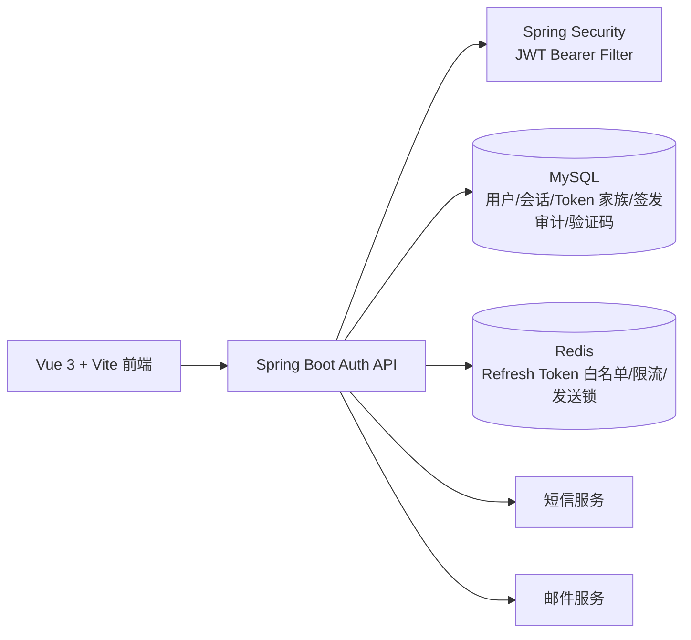

# C-53 登录认证模块开发方案（评审稿）

> 状态：后端与前端已实施，待审查  
> 版本：1.0  
> 日期：2026-10-22  
> 输入：`docs/auth-api.md` v1.2、`C-53_be/src/main/resources/db/auth/auth-schema-v2.sql` v2.2、`docs/db/auth-database-design.md` v2.2、`docs/C-53-auth-openapi.yaml` v1.0、现有 `C-53_fe` 前端  
> 说明：附件《登录模块开发文档.md》目前只确定技术栈，本方案在其基础上展开；原附件未改动。

## 1. 评审摘要

`C-53_be` 已按本方案完成 Spring Boot 后端实现，`C-53_fe` 已完成接口路径、注册字段和会话恢复对齐。仓库同时存在两套契约：`auth-api.md` v1.2 与 `C-53-auth-openapi.yaml` v1.0，当前实现以 `auth-api.md` v1.2 为正式基线。

**建议在编码前先冻结一套唯一契约。本文默认以 `docs/auth-api.md` v1.2 为基线**，理由：

- `auth-api.md` 是较新的 v1.2，覆盖验证码、注册、密码登录、验证码登录、刷新、退出、设备账号、切换账号和 `/me`。
- 数据库设计 v2.2 已按 `auth-api.md` 重新设计，并通过 MySQL 5.7.36 建表和约束验证；Refresh Token 白名单由 Redis 权威维护，MySQL 只保留家族与签发审计。
- OpenAPI v1.0 没有 `verificationId`、设备账号和账号切换，且用户 ID 使用整数，与当前数据库和安全方案不一致。

如果评审决定以 OpenAPI 为基线，需要同步简化数据库和设备账号功能，并重新评估验证码安全设计；不建议两套契约同时作为正式契约维护。

## 2. 需要评审确认的决策

| 编号 | 决策点 | 建议方案 | 影响 |
|---|---|---|---|
| D1 | 契约基线 | 以 `auth-api.md` v1.2 为唯一正式契约，OpenAPI 和前端后续对齐 | 决定接口、DTO、前端改造量 |
| D2 | JWT 认证方式 | Spring Security + 自定义 JWT Bearer Filter + 自定义登录/刷新端点，不做标准授权码流程 | 若后续要求标准 OAuth2，再迁移到 Resource Server/Authorization Server |
| D3 | Token 有效期 | Access 15 分钟；Refresh 7 天（保持登录）/ 24 小时（不保持）；全部配置化 | 安全性与前端刷新频率 |
| D4 | 注册资料 | 注册页新增 `nickname`、`username`，并接入用户名可用性检查 | 前端需要改表单和校验 |
| D5 | 找回密码 | 本期暂不做，先隐藏前端入口；如纳入本期，增加 `reset_password` 场景和接口 | 增加约 1.5 人天及安全测试 |
| D6 | Refresh Token 保存 | 首版按接口契约放在响应体；后续切换 HttpOnly Cookie | 首版开发快，二期安全加固 |
| D7 | 短信/邮件服务 | 先定义 `VerificationSender` 接口，开发环境用固定验证码模拟，生产接短信/邮件供应商 | 供应商资质和密钥是外部依赖 |
| D8 | 数据库版本 | 开发/测试使用 MySQL 8.0；现有 DDL 同时兼容 5.7 | 5.7 的 CHECK 不生效，需应用层校验 |

## 3. 目标与范围

### 3.1 本期目标

- 完成 `auth-api.md` 定义的登录注册闭环。
- 完成 Access/Refresh 双令牌、会话撤销、刷新令牌轮换和重复使用检测。
- 完成设备会话、已保存账号列表和快速切换账号。
- 完成用户名可用性检查、协议同意记录、登录失败限流和审计。
- 完成前端登录、注册、验证码、退出、账号切换和会话恢复联调。
- 提供可执行的数据库迁移、接口文档、测试用例和本地启动方式。

### 3.2 不在本期范围

- 社区动态、评论、关注、私信、通知等业务功能；`/me` 中的未读数先返回 0 或以接口占位。
- 第三方 OAuth2 授权码登录、微信/QQ 登录。
- 管理后台、用户封禁后台、风控规则平台。
- 短信/邮件供应商采购和资质申请。
- 找回密码和邮箱/手机号换绑，除非 D5 评审确认纳入。

## 4. 契约差异与处理建议

| 主题 | `auth-api.md` v1.2 | OpenAPI v1.0 / 前端现状 | 建议 |
|---|---|---|---|
| 发送验证码 | `POST /auth/verification-codes`，字段 `scene/channel/target`，返回 `verificationId/maskedTarget/expiresIn/resendAfter` | `POST /auth/send-code`，字段 `scene/identifierType/identifier`，不返回 `verificationId` | 后端实现 auth-api 路径；前端改造；过渡期可加 `/auth/send-code` 别名 |
| 注册字段 | `nickname/username/contact/contactType/verificationId/verificationCode/password/agreed` | `identifierType/identifier/code/password/agreeTerms`，无昵称和用户名 | 按 auth-api 实现，注册页补字段 |
| 密码登录 | `POST /auth/login`，`account/password/remember` | `POST /auth/login`，`identifierType/identifier/password` | 前端改为 `account` 字符串 |
| 验证码登录 | `POST /auth/login/code`，`account/channel/verificationId/verificationCode/remember` | `POST /auth/login`，`identifierType/identifier/code` | 前端保存 `verificationId` 并改用独立路径 |
| 刷新令牌 | `POST /auth/refresh`，返回 `AuthSession` 结构 | 旧前端使用 `POST /auth/token/refresh`；服务层已改为 `/auth/refresh` | 以 auth-api 为准；后端过渡期可保留旧路径别名 |
| 退出登录 | `POST /auth/logout`，Bearer 认证，返回 204 | 请求体携带 `refreshToken` | 前端改为只带 Authorization；后端可兼容请求体但忽略 |
| 当前用户 | `GET /me`，返回 `user/session/unread` | `GET /auth/me`，返回用户和状态 | 实现 `/me`，过渡期保留 `/auth/me` 别名 |
| 已保存账号/切换 | `GET /auth/accounts`、`POST /auth/switch` | OpenAPI 未定义，前端已调用 | 按 auth-api 实现 |
| 找回密码 | 未定义 | `POST /auth/password/reset` | 本期先隐藏前端入口，待 D5 决定 |
| 用户 ID | 字符串，如 `usr_...` | 整数 `int64` | 使用字符串 ID，前端不得假定数字 |
| Token 有效期 | Access 15 分钟；Refresh 7 天（保持登录）/ 24 小时（不保持） | Access 15 分钟 / Refresh 7 天 | 配置化，采用 15 分钟 / 7 天 / 24 小时 |
| 响应包装 | `{code,data,requestId}` / 错误 `{code,message,details,requestId}` | 直接返回数据；错误带 `timestamp/path` | 统一使用 auth-api 包装；前端 `request()` 已兼容 `data` 解包 |

### 4.1 兼容策略

为了避免前端改造期间接口不可用，建议：

1. 正式接口严格按 `auth-api.md` 实现。
2. Controller 增加旧路径别名：`/auth/send-code`、`/auth/token/refresh`、`/auth/me`。
3. 旧别名只做 DTO 转换，复用同一 Service，标记 `@Deprecated`，前端完成后删除。
4. 不为旧字段建立第二套业务逻辑，避免出现两套验证码和会话行为。

## 5. 技术架构

### 5.1 总体结构



### 5.2 技术选型

| 层次 | 选型 | 说明 |
|---|---|---|
| 运行时 | Java 21 | 当前环境已安装 Java 21 |
| 框架 | Spring Boot 3.2.5 | 与 Java 21 和 Spring Security 6 对齐 |
| 安全 | Spring Security 6 + 自定义 JWT Bearer Filter | Access JWT 校验、统一 401/403 |
| 数据访问 | Spring JDBC / JdbcTemplate | 显式 SQL，便于审核索引和事务边界 |
| 数据库 | MySQL 8.0（兼容 5.7 DDL） | 使用 `utf8mb4`，时间存 UTC |
| 缓存 | Redis 7.x | Refresh Token 白名单权威源、限流、验证码发送锁；AOF + noeviction |
| 迁移 | Spring SQL Init | 启动时执行幂等 `auth-schema-v2.sql`，后续量产后切换 Flyway/Liquibase |
| 接口文档 | Markdown 契约 | `docs/auth-api.md` 作为联调与验收基线 |
| 参数校验 | Jakarta Validation | DTO 校验 + 业务校验 |
| 密码哈希 | BCrypt cost 12 | 新用户直接使用 BCrypt；未来可平滑迁移 Argon2id |
| 测试 | JUnit 5 + Mockito + 远端 MySQL/Redis 联调 | 单元测试随构建运行，中间件场景使用虚拟机环境验收 |

### 5.3 认证实现说明

本期不建议引入完整 Spring Authorization Server。原因是现有契约是自定义的：

- 用户名/邮箱/手机号 + 密码登录。
- 手机号/邮箱 + 验证码登录。
- 自定义 Refresh Token 轮换和重复使用检测。

当前采用 **自定义 JWT Bearer Filter**：

- 本模块签发 Access JWT。
- `JwtAuthenticationFilter` 负责 JWT 解码、签名校验、过期校验和 `Bearer` 认证。
- 自定义登录/刷新接口负责签发 Token。
- 未来如果需要给第三方应用授权，再引入 Spring Authorization Server 或独立授权服务。

### 5.4 包结构

```text
com.c53
├── C53Application.java
├── modules
│   └── auth
│       ├── controller  AuthController、MeController
│       ├── dto         AuthDtos
│       ├── model       AuthModels
│       ├── redis       RefreshTokenStore
│       ├── repository  User/Session/Audit/Verification/Device/Agreement Repository
│       ├── service     AuthService、VerificationService、TokenService、DeviceService
│       └── support     AuthUtils、HmacService
├── common           ApiResponse、ApiException、GlobalExceptionHandler、RequestIdFilter
│   └── support      IdGenerator、JdbcTime
├── config           AuthProperties
└── security         AuthPrincipal、JwtService、JwtAuthenticationFilter、SecurityConfig
```

后续模块统一放在 `com.c53.modules.<module>`，例如 `com.c53.modules.content`、`com.c53.modules.profile`。共享能力放 `com.c53.common`，安全与配置放 `com.c53.security` 和 `com.c53.config`，业务模块不要反向污染共享包。

## 6. 数据库与缓存设计

### 6.1 数据库

认证模块 DDL 位于后端资源目录 `C-53_be/src/main/resources/db/auth/auth-schema-v2.sql`，由 Spring SQL Init 自动执行：

```text
C-53_be/src/main/resources/db/auth/auth-schema-v2.sql -> target/classes/db/auth/auth-schema-v2.sql
spring.sql.init.schema-locations=classpath:db/auth/auth-schema-v2.sql
```

DDL 使用 `CREATE TABLE IF NOT EXISTS`，重复启动不会重建已有表。正式投产前若需要版本化变更，再引入 Flyway/Liquibase。

核心表：

| 表 | 用途 |
|---|---|
| `users` | 账号、密码摘要、公开资料、状态 |
| `user_contacts` | 邮箱/手机号、验证状态和首选联系方式 |
| `auth_verification_challenges` | 验证码摘要、场景、渠道、有效期、尝试次数 |
| `auth_devices` | 稳定设备身份和风险等级 |
| `auth_device_sessions` | 设备 Cookie 摘要和有效期 |
| `auth_device_accounts` | 已保存账号和 `reauthRequired` |
| `auth_sessions` | 登录会话，JWT 中的 `sid` 指向此表 |
| `auth_token_families` | 会话对应的 Refresh Token 家族及撤销/泄露审计 |
| `auth_refresh_tokens` | Refresh Token 签发审计，只追加，不参与刷新验权 |
| `auth_login_attempts` | 登录尝试审计和限流降级 |
| `auth_user_agreements` | 协议类型、版本和同意时间 |

实现要求：

- 所有 ID 由应用生成：`usr_`、`ct_`、`dev_`、`ds_`、`acc_`、`ses_`、`fam_`、`rt_`、`ver_`，使用 ULID + 前缀。
- 时间统一用 UTC；Jackson 输出 ISO 8601，数据库连接设置 `time_zone=+00:00`。
- 唯一键冲突由数据库兜底，Service 捕获后转换为 `USERNAME_TAKEN` / `CONTACT_TAKEN`。
- MySQL 5.7 不执行 `CHECK`，应用层仍要校验枚举、长度和布尔值。
- 登录/切换前先撤销同设备同用户的旧会话，再创建新会话；Redis 白名单写成功后才返回令牌。
- `auth_refresh_tokens` 只追加签发审计，禁止通过更新该表实现消费、撤销或轮换。

### 6.2 Redis Key 建议

| Key 模式 | 用途 | TTL |
|---|---|---|
| `auth:rt:token:{tokenHash}` | Refresh Token 白名单 Hash：`sessionId/familyId/userId/issuedAt/expiresAt` | 当前令牌剩余有效期 |
| `auth:rt:family:{familyId}:current` | 家族当前有效 Refresh Token 摘要 | 会话剩余有效期 |
| `auth:rt:family:{familyId}:revoked` | 家族撤销标记 | 会话剩余有效期 |
| `auth:rt:used:{tokenHash}` | 已轮换令牌标记，用于重放检测 | 旧令牌原剩余有效期 |
| `auth:code:send:{scene}:{channel}:{target}` | 60 秒发送锁 | 60s |
| `auth:code:hour:{target}` | 每小时发送次数 | 1h |
| `auth:code:day:{target}` | 每日发送次数 | 24h |
| `auth:login:ip:{ip}` | IP 登录失败计数 | 1h |
| `auth:login:account:{accountHash}` | 账号登录失败计数 | 1h |
| `auth:session:{sid}` | 会话有效状态缓存 | 会话剩余时间 |
| `auth:device:{tokenHash}` | 设备会话状态缓存 | 设备会话剩余时间 |
| `auth:switch:{deviceId}` | 账号切换频率 | 1min |
| `auth:idempotency:{key}` | 发布/切换等幂等控制 | 10min |

Refresh Token 是否有效只以 Redis 白名单为准；MySQL 的 `auth_refresh_tokens` 审计表不参与验权，也不作为 Redis 故障回退源。轮换必须用 Lua 原子完成，保证同一旧令牌并发刷新只有一个请求成功。

限流使用 Redis Lua 脚本保证计数和过期原子性；`auth_login_attempts` 只做持久审计和降级，不作为高频计数主存储。

## 7. 接口实现清单

### 7.1 正式接口

| 方法 | 路径 | 认证 | 成功状态 | 主要 Service |
|---|---|---|---:|---|
| POST | `/auth/verification-codes` | 否 | 202 | `VerificationService` |
| POST | `/auth/register` | 否 | 201 | `AuthService.register` |
| GET | `/auth/username-availability` | 否 | 200 | `UserService` |
| POST | `/auth/login` | 否 | 200 | `AuthService.loginByPassword` |
| POST | `/auth/login/code` | 否 | 200 | `AuthService.loginByCode` |
| POST | `/auth/refresh` | Refresh Token | 200 | `TokenService.refresh` |
| POST | `/auth/logout` | Bearer | 204 | `AuthService.logout` |
| GET | `/auth/accounts` | 设备 Cookie | 200 | `SavedAccountService.list` |
| POST | `/auth/switch` | 设备 Cookie | 200 | `AuthService.switchAccount` |
| GET | `/me` | Bearer | 200 | `MeService` |

### 7.2 过渡期别名

| 旧路径 | 映射 |
|---|---|
| `POST /auth/send-code` | 转换为 `POST /auth/verification-codes` |
| `POST /auth/token/refresh` | 转换为 `POST /auth/refresh` |
| `GET /auth/me` | 转换为 `GET /me` |

### 7.3 统一响应与错误

成功：

```json
{
  "code": "OK",
  "data": {},
  "requestId": "req_01K5..."
}
```

失败：

```json
{
  "code": "VALIDATION_ERROR",
  "message": "用户名格式不正确",
  "details": [{ "field": "username", "reason": "invalid_format" }],
  "requestId": "req_01K5..."
}
```

`ErrorCode` 至少覆盖 auth-api 中的业务码：`INVALID_CREDENTIALS`、`INVALID_VERIFICATION_CODE`、`VERIFICATION_CODE_EXPIRED`、`VERIFICATION_ATTEMPTS_EXCEEDED`、`INVALID_REFRESH_TOKEN`、`REAUTH_REQUIRED`、`ACCOUNT_DISABLED`、`USERNAME_TAKEN`、`CONTACT_TAKEN`、`RATE_LIMITED`、`SERVICE_UNAVAILABLE` 等。Redis 不可用、超时或写入失败统一映射为 HTTP 503。

### 7.4 `/me` 的未读数

`/me` 返回结构包含 `unread.notifications` 和 `unread.messages`。登录模块本期先返回 0，并在接口层预留聚合接口；等通知/私信模块完成后替换为真实计数，避免登录模块耦合社区业务表。

## 8. 核心流程设计

### 8.1 发送验证码

1. 校验 `scene`、`channel`、`target`，规范化邮箱小写或手机号 E.164。
2. 用 Redis 检查 60 秒发送锁和小时/天级限额。
3. 将该目标、场景、渠道下仍为 `ACTIVE` 的旧挑战标记为 `INVALIDATED`。
4. 创建 `PENDING` 挑战，生成 6 位密码学随机码并写 HMAC 摘要。
5. 调用 `VerificationSender` 发送。
6. 发送成功后置 `ACTIVE`、写 `sent_at`；失败置 `FAILED`，不保留可用验证码。

业务要求：

- `login` 场景无论账号是否存在都返回相同结构。
- 响应包含 `verificationId`，注册/验证码登录必须回传。
- 日志、监控、链路追踪不得输出验证码明文。

注意：可以先展示不接入邮箱和验证码服务，在控制台输出六位随机验证码，但是需要预留服务接口，后期能够平滑过渡

### 8.2 注册

在单个数据库事务内完成：

1. `SELECT ... FOR UPDATE` 锁定 `verificationId` 对应的挑战。
2. 校验状态、有效期、尝试次数、目标、渠道、场景。
3. 校验验证码摘要；成功后置 `CONSUMED`，保证只能消费一次。
4. 插入 `users`：用户名小写、密码 Argon2id/BCrypt 哈希、联系方式及验证标记。
5. 写入 `auth_user_agreements`，记录社区公约和隐私政策版本。
6. 获取或创建设备会话，写入/更新 `auth_device_accounts`。
7. 创建 `auth_sessions` 和 `auth_token_families`，提交 MySQL 事务。
8. 提交后写入首个 Refresh Token 的 Redis 白名单；Redis 失败时补偿撤销新会话和家族并返回 503。
9. 尽力追加首个 `auth_refresh_tokens` 签发审计；审计失败只告警。
10. 返回 `AuthSession` 和 `Set-Cookie`，注册成功后可以直接登录。

外部短信/邮件发送不在数据库事务内；先完成验证码消费和账号写入，再异步发欢迎邮件等非关键通知。

### 8.3 登录流程

1. 客户端发送登录请求，包含标识符（用户名、手机号或邮箱）和登录凭证。
2. 服务端校验标识符格式、用户状态和登录凭证；账号不存在与密码错误统一返回 `INVALID_CREDENTIALS`。
3. 创建或复用设备及设备会话，并在 MySQL 事务中创建 `auth_sessions` 和 `auth_token_families`。
4. 提交 MySQL 事务后签发 Access Token 和 `rt_v1_<随机值>` 格式的 Refresh Token，并将 Refresh Token 摘要、会话、家族和过期时间写入 Redis 白名单，TTL 与本次登录有效期一致。
5. Redis 写入失败时补偿撤销刚创建的会话和家族，返回 `503 SERVICE_UNAVAILABLE`，不签发可用令牌。
6. 尽力追加 `auth_refresh_tokens` 签发审计；审计失败只记录告警和指标，不回滚已成功的登录。
7. 返回用户信息和令牌对。

### 8.4 刷新令牌

1. 解析 `rt_v1_<随机值>` 的版本前缀，计算 HMAC-SHA256 摘要 `tokenHash`。
2. 读取 `auth:rt:token:{tokenHash}`。Key 不存在时，若 `auth:rt:used:{tokenHash}` 存在则判定重放；两者都不存在则返回 `INVALID_REFRESH_TOKEN`。
3. 检查 `auth:rt:family:{familyId}:revoked`；存在时返回 `INVALID_REFRESH_TOKEN`。
4. 检查 `auth:rt:family:{familyId}:current` 是否等于旧摘要，并核对 Token 元数据中的 `sessionId/familyId/userId`。旧 Token 已不属于当前家族时判定重放。
5. 查询 `auth_sessions` 和用户状态，要求会话未撤销、未过期且用户为 ACTIVE。
6. 生成新 Refresh Token，通过 Lua 原子完成：再次比较 current 仍等于旧摘要、删除旧 token Key、写 used 标记、写新 current、写新 token Key，并设置滑动续期后的 TTL。
7. Lua 返回冲突时重新读取 used 标记：命中则按重放处理，否则返回 `INVALID_REFRESH_TOKEN`。
8. Redis 轮换成功后，在 MySQL 事务中更新 `auth_sessions.last_active_at/expires_at` 和 `auth_token_families.expires_at`。
9. 尽力追加新 Token 的 `auth_refresh_tokens` 签发审计；审计失败只告警，不使刷新失败。
10. 返回新的 Access Token、Refresh Token 和 `sessionId`。

重放处理：

- 立即在 Redis 写家族 revoked 标记，删除 token/current Key。
- 撤销 MySQL 会话和家族，写 `compromised_at` 及撤销原因 `reuse_detected`。
- 返回 `401 INVALID_REFRESH_TOKEN`；调用方不得收到新令牌。

Redis 连接失败、超时、Lua 执行失败或 `noeviction` 导致写失败时统一返回 `503 SERVICE_UNAVAILABLE`，不得回退 MySQL 审计表判定令牌有效。

并发要求：

- 前端对同一浏览器的刷新请求做 single-flight。
- 后端通过 Redis Lua 原子比较 current 并完成轮换，只有 current 仍等于旧摘要的请求可以成功。
- MySQL 只更新会话和家族有效期并追加审计，不参与并发令牌消费判定。
- 多标签页并发刷新需在联调中专门验证；必要时增加短时间幂等窗口，但不能放宽重复使用检测。

### 8.5 退出登录

1. 从 Access Token 取 `sid`。
2. 撤销 `auth_sessions` 当前会话，撤销原因写 `logout`。
3. 撤销对应 `auth_token_families`，保留已写入的签发审计。
4. 删除 Redis 中该家族的 token/current Key，并写 `auth:rt:family:{familyId}:revoked` 标记至会话过期。
5. 返回 204。
6. 设备会话和已保存账号保留，便于下次快速切换；用户主动“退出并移除设备”时再撤销设备会话。

### 8.6 已保存账号与切换

1. 用设备 Cookie 摘要查找有效 `auth_device_sessions`。
2. 关联 `auth_device_accounts` 和 `users`，返回展示字段，不返回密码或 Token。
3. `current` 按当前 `sid` 或该设备最近活跃会话计算，不落库。
4. 切换时校验账号映射归属、用户状态和 `reauth_required`。
5. `reauth_required=1` 返回 `REAUTH_REQUIRED`，前端引导密码登录。
6. 切换成功创建新会话和家族，提交后写 Redis 白名单并尽力追加签发审计；Redis 失败时补偿撤销新会话和家族并返回 503。
7. 更新 `last_used_at`，写切换审计记录。

### 8.7 `/me` 会话恢复

1. 校验 JWT 签名、过期、`typ=access`。
2. 用 `sid` 检查会话未撤销、未过期，用户为 `ACTIVE`。
3. 返回 `user`、`session.createdAt`、`session.lastActiveAt` 和未读数。
4. `last_active_at` 做节流更新，例如 5 分钟一次。

## 9. 安全与风控

### 9.1 基础安全

- 密码：Argon2id；兼容存量 BCrypt；禁止 MD5/SHA1/明文。
- 验证码：6 位随机、5 分钟有效、最多 5 次、一次性消费。
- 摘要：验证码、Refresh Token、设备 Cookie 使用 HMAC-SHA256，比较使用常量时间比较。
- Access Token：JWT，短期有效；`sid` 关联会话，退出后立即失效。
- Refresh Token：`rt_v1_` 不透明随机串，Redis 白名单保存摘要和元数据，MySQL 只保存签发审计摘要；通过 Lua 原子轮换并检测重复使用。
- 设备 Cookie：`HttpOnly`、`Secure`（生产）、`SameSite=Lax`，只存摘要。
- 日志：统一脱敏，不记录密码、验证码、Token、设备 Cookie 明文。
- 密钥：JWT 私钥、HMAC 密钥、数据库密码通过环境变量/密钥管理系统注入。

### 9.2 限流

| 接口 | 建议限制 |
|---|---|
| 密码登录 | 5 次/分钟/IP，20 次/小时/账号 |
| 注册 | 3 次/小时/IP，5 次/天/设备 |
| 发送短信验证码 | 1 次/60 秒/手机号，5 次/小时，10 次/天 |
| 发送邮箱验证码 | 1 次/60 秒/邮箱，10 次/小时，20 次/天 |
| 校验验证码 | 5 次/挑战 |
| 用户名检查 | 30 次/分钟/IP |
| 刷新令牌 | 20 次/小时/会话 |
| 账号切换 | 10 次/分钟/设备 |

Redis 做高频限流；`auth_login_attempts` 做审计和 Redis 故障时的降级判断。连续失败采用递增延迟或临时锁定，不无限重试。

### 9.3 CSRF 与 CORS

- 仅使用 Authorization Header 的接口不依赖 Cookie，CSRF 风险低。
- `/auth/accounts` 和 `/auth/switch` 依赖设备 Cookie，必须设置 `SameSite=Lax` 或更严格策略；前端与后端同源部署时优先同源。
- 如前后端跨域，CORS 明确配置允许来源，开启 `allowCredentials`，不使用通配符。
- 设备 Cookie 接口建议增加 CSRF Token 或自定义请求头校验，防止跨站切换账号。

### 9.4 账号枚举与审计

- 密码登录统一错误文案。
- 验证码登录不暴露账号是否存在，发送接口始终返回相同结构。
- 用户名检查只返回可用性，不作为注册唯一性依据。
- 记录登录、注册、验证码发送、刷新重复使用、账号切换的成功/失败事件，日志带 `requestId`。

## 10. 前端改造清单

当前前端已具备登录、注册、重置密码页面，但需要与正式契约对齐。

| 文件/模块 | 改造内容 |
|---|---|
| `C-53_fe/src/services/api.js` | 路径改为 `/auth/verification-codes`、`/auth/login/code`、`/auth/refresh`、`/me`；保留旧路径别名过渡 |
| `C-53_fe/src/App.vue` | 登录/注册状态增加 `verificationId`、`channel`、`target`；改为发送 `account`、`verificationId`、`verificationCode` |
| `RegisterView.vue` | 新增昵称、用户名字段；密码改为必填；接入用户名可用性检查 |
| `LoginView.vue` | 验证码登录显示倒计时和脱敏目标；切换已保存账号失败时处理 `REAUTH_REQUIRED` |
| `App.vue` 启动流程 | 本地有 Access Token 时调用 `/me` 恢复会话，不只依赖布尔值 |
| `saveSession` | 保存 `accessToken`、`refreshToken`、`sessionId`；后续切换到 HttpOnly Cookie |
| 刷新拦截器 | 仅 `401/403` 认证失败时清理会话；刷新返回 `503 SERVICE_UNAVAILABLE` 时保留本地凭据并提示重试 |
| `logout` | 只带 Authorization 调用 `/auth/logout`，不依赖请求体 |
| 设备账号 | `fetch` 对账号列表/切换请求携带设备 Cookie（`credentials: 'include'`） |
| 演示数据 | 已保存账号为空时不展示任何演示账号；不要回退到 `data/accounts.js` 固定账号 |

前端字段映射建议：

| 前端旧字段 | 后端正式字段 |
|---|---|
| `identifierType: PHONE/EMAIL` | `channel: sms/email` + `contactType: phone/email` |
| `identifier` | `target` 或 `contact` |
| `scene: LOGIN/REGISTER` | `scene: login/register` |
| `code` | `verificationCode` |
| `agreeTerms` | `agreed` |
| `resendAfterSeconds` | `resendAfter` |
| `expireSeconds` | `expiresIn` |

## 11. 测试与验收

### 11.1 测试分层

| 层级 | 内容 |
|---|---|
| 单元测试 | 账号规范化、用户名/密码校验、HMAC、JWT claims、限流计数、Token 过期计算 |
| Service 测试 | 注册事务、验证码消费、登录、刷新轮换、重复使用、退出、切换账号 |
| 接口测试 | 当前以真实 HTTP 联调覆盖统一响应、错误码和状态码；MockMvc 可作为后续 CI 增强 |
| 集成测试 | 远端 MySQL 5.7 + Redis 7 真实环境；验证 DDL、事务、唯一索引和 Redis 白名单 |
| 并发测试 | 验证码并发消费、同一 Refresh Token 并发刷新、重复注册、账号切换并发 |
| Redis 集成测试 | 首次签发、正常轮换、重放撤销、并发刷新、退出失效、7 天/24 小时 TTL、家族到期 |
| 故障测试 | Redis AOF 重启恢复、Redis 不可用时刷新返回 503、`noeviction` 写失败不误判成功 |
| 审计降级测试 | MySQL 签发审计写入失败不影响登录/刷新；Redis 数据丢失时不得回退 MySQL Token 表 |
| 前端联调 | 登录、注册、验证码倒计时、刷新、退出、保存账号、`REAUTH_REQUIRED` |

### 11.2 必测场景

- 用户名、邮箱、手机号三种密码登录。
- 手机号、邮箱验证码登录。
- 注册验证码不能用于登录，登录验证码不能用于注册。
- 验证码过期、错误、重复消费、目标不匹配、超过 5 次。
- 验证码 60 秒重发限制和小时/天级限流。
- 用户名、邮箱、手机号重复注册返回明确字段错误。
- 错误账号和错误密码返回统一错误。
- Refresh Token 轮换后旧 Token 返回 401；旧 Token 重复使用撤销整个家族。
- 同一家族在 MySQL 中可追加多条签发审计，重复 `token_hash` 被唯一索引拒绝。
- 并发刷新同一旧令牌时只有一个请求成功；失败请求不得得到可用的新令牌。
- 退出后 Redis 中对应 token/current Key 被删除，家族 revoked 标记生效。
- Redis 重启后 AOF 能恢复未过期的 Refresh Token 白名单。
- Redis 停止、超时或 `noeviction` 写失败时，刷新接口返回 `503 SERVICE_UNAVAILABLE`，不回退 MySQL 验权。
- 前端收到刷新 503 时保留本地凭据并提示重试，不清空会话；Redis 恢复后可继续刷新。
- MySQL 签发审计写入失败时登录和刷新仍成功，并产生告警/指标。
- 退出后旧 Access Token 访问 `/me` 返回 401。
- 设备账号列表为空时返回空数组；切换账号不传输密码。
- `reauthRequired=true` 时切换返回 `REAUTH_REQUIRED`。
- 禁用用户登录返回 `ACCOUNT_DISABLED`。
- 所有中文错误信息 UTF-8 正常返回。

### 11.3 验收标准

- `mvn test` 全部通过；刷新轮换、并发宽限、重放撤销、Redis 故障和退出撤销已有服务层测试。
- `npm run build` 通过，前端与后端联调无阻断错误。
- `auth-schema-v2.sql` 能在空库创建全部表，重复执行不报错。
- 接口路径、字段和错误码与 `auth-api.md` 一致，旧路径只作为别名。
- `docker-compose.yml` 可启动 MySQL 和 Redis；当前联调环境使用虚拟机上的 MySQL/Redis。
- Redis 配置为 `appendonly yes`、`appendfsync everysec`、`maxmemory-policy noeviction`，并通过持久化数据卷保存 AOF。
- 代码中无明文密码、验证码、Refresh Token、设备 Cookie 日志。
- 认证接口错误码、状态码和响应结构与契约一致。

## 12. 排期与交付物

以下为建议排期，单位为人天，不含短信/邮件供应商资质等待时间。

| 阶段 | 工作 | 人天 | 交付物 |
|---|---|---:|---|
| M0 | 契约冻结、接口评审、字段最终确认 | 1 | 评审通过的契约清单 |
| M1 | 后端工程脚手架、配置、SQL Init、统一响应/异常 | 1.5 | 可启动的 Spring Boot 工程 |
| M2 | 验证码发送、HMAC、Redis 限流、开发环境模拟发送 | 2 | 验证码接口和限流测试 |
| M3 | 注册、密码登录、验证码登录、会话和 Refresh 签发 | 3 | 登录注册闭环 |
| M4 | 刷新轮换、重复使用检测、退出、`/me`、设备账号/切换 | 2 | 完整认证会话能力 |
| M5 | 前端 API 对齐、表单字段、会话恢复、账号切换 | 2 | 前后端联调版本 |
| M6 | 集成测试、并发测试、安全测试、文档和本地部署 | 2 | 验收版本 |
| 缓冲 | 联调问题、供应商接入、评审返工 | 2 | 风险缓冲 |
| **合计** |  | **15.5** | 约 15～16 人天 |

关键路径：契约冻结 → 数据库迁移 → 验证码/会话服务 → 前端联调。短信邮件供应商可以先用开发模拟器并行推进，不阻塞主流程。

### 12.1 交付物清单

- `C-53_be`：可启动的 Spring Boot 后端工程。
- `C-53_be/src/main/resources/db/auth/auth-schema-v2.sql`：认证模块幂等建表脚本，由后端启动时自动执行。
- `docs/登录模块开发方案.md`：本评审稿及评审后的修订版。
- `docs/auth-api.md`：已冻结的正式接口契约；OpenAPI 文件保留为历史参考。
- `C-53_fe`：登录/注册/验证码/退出/账号切换/会话恢复改造。
- 测试报告：单元、接口、集成、并发和安全场景结果。
- `docker-compose.yml`：MySQL 8.0、Redis 7 启动配置；Redis 强制 AOF 与 `noeviction`。

## 13. 风险清单

| 风险 | 影响 | 应对 |
|---|---|---|
| 两套契约并存 | 前后端返工、测试标准不一致 | 评审先冻结 auth-api；旧路径只做别名 |
| 前端注册缺少昵称/用户名 | 注册无法按契约完成 | 增加表单项或明确自动生成规则 |
| 验证码没有 `verificationId` | 无法安全绑定挑战，易被重放 | 采用 auth-api 的挑战模型 |
| Refresh Token 多标签并发 | 误触发家族撤销 | 前端 single-flight + Redis Lua 原子轮换 + 并发测试 |
| Redis 不可用或数据丢失 | 所有刷新失败，用户需重新登录 | AOF everysec、noeviction、503 明确语义、监控与告警；禁止 MySQL 回退验权 |
| MySQL 审计写入失败 | 安全审计缺口 | 签发审计异步/尽力写入，失败告警，不回滚已成功认证 |
| 设备 Cookie 跨域/CSRF | 账号切换被跨站利用 | SameSite、CORS 白名单、CSRF Token |
| MySQL 5.7 CHECK 不生效 | 脏数据进入库 | 应用层校验 + 集成测试 |
| 短信/邮件发送失败 | 验证码不可用 | 失败置 FAILED；开发环境模拟发送 |
| Token 密钥管理缺失 | 令牌可伪造或无法轮换 | 环境变量/密钥管理；预留 key version |
| 用户 ID 类型不一致 | 前端/接口解析错误 | 统一字符串 ID，OpenAPI 同步修正 |

## 14. 评审清单

请评审时逐项确认或修改：

- [x] D1：正式接口文档需要重新设计，先完成登录模块的接口文档
- [x] D2：当前采用自定义 JWT Bearer Filter，不引入完整 Authorization Server。
- [x] D3：确认 Access 15 分钟、Refresh 7 天/24 小时。
- [x] D4：注册页新增昵称和用户名，还是由后端自动生成。
- [x] D5：找回密码是否纳入本期。
- [x] D6：Refresh Token 首版放响应体，还是直接使用 HttpOnly Cookie。
- [x] D7：短信/邮件供应商及开发环境模拟方式。
- [x] D8：开发数据库使用 MySQL 8.0 还是 5.7。
- [x] 旧接口别名保留一个过渡期，正式路径为 `/api/v1/auth/*`。
- [x] `/me` 未读数本期是否允许返回 0。
- [x] 是否需要 Docker Compose 作为本地交付物。

## 15. 实施完成情况与运行方式

### 15.1 已交付

- 后端 `C-53_be`：工程标识 `c53-server`，Spring Boot 3.2.5、Java 21、Spring JDBC、Spring Security、Spring Data Redis。
- 业务模块：认证模块位于 `com.c53.modules.auth`，后续模块使用 `com.c53.modules.<module>`；目录规则见 `docs/后端工程目录规范.md`。
- 前端 `C-53_fe`：接口路径、注册昵称/用户名、验证码登录 `verificationId`、刷新 503 保留凭据。
- 数据库：`C-53_be/src/main/resources/db/auth/auth-schema-v2.sql` 幂等建表，包含 11 张认证相关表。
- Redis：Refresh Token 白名单为唯一权威源，Lua 原子轮换，AOF 与 `noeviction`。
- 测试：13 个单元测试通过；远端 MySQL/Redis 真实接口联调通过。

### 15.2 Maven 个人仓库

项目已通过 `C-53_be/.mvn/maven.config` 固定使用个人仓库，无需每次手工传参：

```text
C:\Users\wh320\.m2\repository-personal
```

等价命令：

```powershell
cd C:\Users\wh320\OneDrive\Desktop\C-53\C-53_be
mvn -o test
mvn -o spring-boot:run
```

如需显式审计仓库解析结果：

```powershell
mvn -o -s maven-settings.xml -Dmaven.repo.local=C:\Users\wh320\.m2\repository-personal help:evaluate "-Dexpression=settings.localRepository" -q -DforceStdout
```

### 15.3 运行配置

默认连接本机 `localhost` 的 MySQL 和 Redis，可通过环境变量覆盖：

- `DB_HOST`、`DB_PORT`、`DB_NAME`、`DB_USERNAME`、`DB_PASSWORD`。
- `REDIS_HOST`、`REDIS_PORT`、`REDIS_PASSWORD`、`REDIS_DATABASE`。
- `AUTH_JWT_SECRET`、`AUTH_HMAC_SECRET` 必须在生产环境替换默认值。
- `AUTH_VERIFICATION_DEV_MODE=true` 仅用于开发环境，生产必须关闭并接入真实短信/邮件供应商。

Redis 必须启用 `appendonly yes`、`appendfsync everysec`、`maxmemory-policy noeviction`；不可用、超时或写失败统一返回 `503 SERVICE_UNAVAILABLE`。

### 15.4 接口路径

正式路径为 `/api/v1/auth/*`，同时保留 `/auth/*` 过渡别名：

- `/api/v1/auth/verification-codes`、`/auth/verification-codes`、`/auth/send-code`。
- `/api/v1/auth/refresh`、`/auth/refresh`、`/auth/token/refresh`。
- `/api/v1/me`、`/api/v1/auth/me`、`/me`、`/auth/me`。

并发刷新同一旧令牌时，5 秒宽限期内后到请求返回 `409 REFRESH_IN_PROGRESS`；宽限期后仍使用旧令牌判定为重放，返回 `401 INVALID_REFRESH_TOKEN` 并撤销整个家族。

### 15.5 验收结果

```text
BUILD SUCCESS
Tests run: 13, Failures: 0, Errors: 0, Skipped: 0
REFRESH=200:rotated=True
REPLAY=401:INVALID_REFRESH_TOKEN
ME_AFTER_REPLAY=401:SESSION_REVOKED
REFRESH_AFTER_LOGOUT=401:INVALID_REFRESH_TOKEN
REFRESH_REDIS_DOWN=503
LOGIN_REDIS_DOWN=503
```

前端 `npm run build` 已通过；Redis 故障时前端不清空本地凭据，收到 `401/403` 才清理会话。

### 15.6 审查关注点

- `VerificationService.send` 当前未绑定设备会话；如发码风控需要设备维度限额，应传入设备 ID。
- 注册成功暂不写 `auth_login_attempts`；当前表约束的 `login_method` 不包含 `register`，如要求注册审计需同步修改 DDL。
- `docker-compose.yml` 为本地容器方案；当前联调实际使用虚拟机中间件，两者配置语义保持一致。
- 未引入 Testcontainers 和 MockMvc 全量接口测试，后续进入 CI 时建议补齐。
